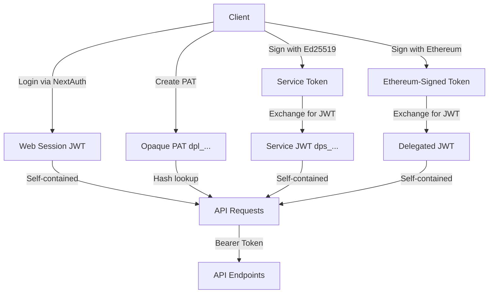

# Authentication Overview

> **Audience:** Prompt Engineers · Product · Agents · Developers

The dapple-prompt API supports four authentication mechanisms, each designed for different use cases.

---

<!-- ANCHOR: comparison -->
## Authentication Methods

| Authentication Type | Use Case | Lifetime | Who Uses It |
|---------------------|----------|----------|-------------|
| **Web Session Tokens (JWT)** | NextAuth.js browser sessions | Session-based | Web UI users |
| **Opaque Personal Access Tokens (PAT)** | Long-lived programmatic access | User-defined (or never) | CLI tools, scripts, integrations |
| **Service Tokens (Ed25519)** | Service-to-service authentication | Short-lived (max 5 min) | Internal services (dapple-ui, conduit, flow) |
| **Ethereum-Signed Tokens** | External service delegation | Short-lived (max 30 min) | Trusted external services with wallets |

> **Note:** Service tokens can produce **two types** of JWTs depending on whether `auth_user_id` is provided:
> - **Service JWT** (`token_use: "service"`): Service acts as itself
> - **Delegated JWT** (`token_use: "delegated"`): Service acts on behalf of a user
>
> See [Service Tokens - Delegated Tokens](./service-tokens.md#delegated-tokens-acting-on-behalf-of-users) for details.
<!-- ANCHOR_END: comparison -->

---

<!-- ANCHOR: token-detection -->
## Token Detection

All authenticated requests require a valid token in the `Authorization: Bearer <token>` header. The API detects token type by format:

| Prefix | Token Type | Validation Method |
|--------|------------|-------------------|
| `dpl_` | Opaque PAT | Hash lookup in database |
| `dps_` | Service Token JWT | Issued via `/api/get-service-token` |
| No prefix (JWT format) | Web Session JWT | Self-contained JWT validation |
<!-- ANCHOR_END: token-detection -->

---

<!-- ANCHOR: flow-diagram -->
## Authentication Flow

<!-- ANCHOR_END: flow-diagram -->

---

<!-- ANCHOR: quick-reference -->
## Quick Reference

| Feature | Web Session | Opaque PAT | Service Token | Ethereum-Signed |
|---------|-------------|------------|---------------|-----------------|
| **Token Type** | Self-contained JWT | Opaque (hash-stored) | Signed → JWT | Signed → JWT |
| **JWT `token_use`** | `"session"` | N/A | `"service"` or `"delegated"` | `"delegated"` |
| **Lifetime** | Session-based | User-defined | Max 5 min (signed) / 1 hr (JWT) | Max 30 min |
| **Creation** | Automatic (NextAuth) | `POST /api/api-tokens/` | Service signs | External service signs |
| **Revocation** | Logout | `DELETE /api/api-tokens/:id` | Revoke in DB | Expires |
| **Key Type** | N/A | N/A | Ed25519 | ECDSA secp256k1 |
| **Rate Limit** | 300 req/min | 60 req/min | Uses JWT limits | Uses JWT limits |

> **Agent Note:** When using Service Tokens, the signed token is short-lived (max 5 min), but the resulting JWT lasts 1 hour. If you receive unexpected 401 errors, the JWT has likely expired. Request a new one via `POST /api/get-service-token`.
<!-- ANCHOR_END: quick-reference -->

---

## Detailed Documentation

- [Web Session Tokens](./web-sessions.md): NextAuth.js browser sessions
- [Opaque Personal Access Tokens](./api-tokens.md): CLI and programmatic access
- [Service Tokens](./service-tokens.md): Internal service-to-service auth
- [Ethereum-Signed Tokens](./ethereum-tokens.md): External service delegation
- [Best Practices](./best-practices.md): Security checklist and guidelines
