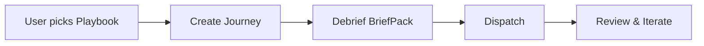

# Core Execution Model

> **Audience:** Prompt Engineers · Product · Agents · Developers

This document describes the core execution model for dapple-prompt workflows.

---

<!-- ANCHOR: task -->
## Task

A Task is the smallest unit of work: a short script or program that performs one clear job (for example: `collect-personal-data`, `format-resume`).

**Good Tasks:**
- Have a single responsibility and minimal external dependencies
- Accept inputs via `IN_ARTIFACT` or stdin and write outputs to `OUT_DIR`
- Produce an `artifact.json` describing the primary artifact (path and type)
- Are idempotent or include resume markers so retries are safe

**Example responsibilities:** Extract structured data from free text, render Markdown to PDF, validate an email address.
<!-- ANCHOR_END: task -->

---

<!-- ANCHOR: setup-step -->
## Setup Step

A Setup Step is a **dynamic sub-interaction within a [Stage](#stage)** — one round-trip of work (and any operator input it needs) that happens *before* the user navigates to the next stage. If a Stage is a form/pane, the Steps are the AJAXy interactions on that pane: the canonical shape is **generate → pick → refine** (a task generates candidates, the operator picks one, a later step refines the pick). A Step groups Tasks that run in a defined order, with deterministic artifact passing and simple retry/resume.

**Multi-step stages are the norm** — that is what Steps are *for*. Per-step status (`GET /api/journeys/{id}/steps`) is the fine-grained completion signal a client uses to know *which* sub-interaction is awaiting input.

**Author checklist:**
- [ ] Define the ordered Task list and expected artifact contract
- [ ] Document which artifact each Task consumes and produces
- [ ] Expose the value slots THIS step needs or produces at the step level (`:::step { expose: [...] }`) — see [Value-Slot Overlays](../../journey-planner-guide/value-slot-overlays.md)

**Example:** `build-resume-step` runs `collect-personal-data` → `format-resume` → `render-pdf`.

**Execution semantics (fail-together):** A Step is an ordered set of Tasks executed as one fail-together unit — a coherence and retry boundary, not a database transaction (nothing rolls back; task attempts, payloads, and assets are always recorded as history). At runtime the Tasks run sequentially in authored order and the Step **stops on the first failure** — later Tasks do not run (it is not log-and-continue). A Task may **veto** the Step by emitting `signals.unsafe = true`, which ends that task attempt in the terminal `unsafe` phase (so the Step's verdict is `unsafe` — do-not-refire, non-retryable). The Step's **computed outputs publish once, together, at coherent Step completion** — a failed or vetoed Step publishes nothing (outputs are never published per-Task). Retry means re-dispatch (latest-wins).
<!-- ANCHOR_END: setup-step -->

---

<!-- ANCHOR: stage -->
## Stage

A Stage is a **static form / pane** the user lands on; advancing to the next stage (stage N → stage N+1) is the real navigation to the next pane. A Stage holds one or more [Steps](#setup-step) — the dynamic sub-interactions that happen on that pane before the user navigates on. A single-step stage (a pane with one round-trip) is the degenerate case, not the model. Stages can pause for human review, branch, or trigger notifications.

A stage's completion (`GET /api/journeys/{id}/stages`, `done` per stage) is the **roll-up of its steps**: the stage is done when every step is. Author the slots a stage gates on via overlays — at the step level for slots a specific step owns, at the stage level only for slots the whole stage shares.
<!-- ANCHOR_END: stage -->

---

<!-- ANCHOR: playbook -->
## Playbook

A Playbook is the runnable orchestration authors build and package. It contains Stages and Steps arranged to produce a user-visible result. Playbooks are the unit you package into Brief Packs and the entity users run.

**Design guidance:** Keep Playbooks focused and composable; prefer many small Playbooks over large monoliths.
<!-- ANCHOR_END: playbook -->

---

<!-- ANCHOR: playbook-instance -->
## Playbook Instance / Run

A Playbook Instance (Run) is a single execution of a Playbook. The runtime creates an instance directory where Tasks write `OUT_DIR`, traces, and artifacts for that run.
<!-- ANCHOR_END: playbook-instance -->

---

<!-- ANCHOR: journey -->
## Journey

A Journey is a product-level story describing user experience over time. A Journey may reference multiple Playbooks and includes UX-level decisions like gating, messaging, and long-lived state.

Treat Journeys as the product design layer; Playbooks implement runnable chapters within that story.



**Key insight:** Users don't interact with Playbooks directly. They experience Journeys. The Journey is the user-facing concept; Playbooks are implementation details.
<!-- ANCHOR_END: journey -->

---

## Execution Hierarchy

```
Journey (product experience)
  └── Playbook (runnable orchestration)
        └── Stage (major phase)
              └── Setup Step (subgoal)
                    └── Task (single unit of work)
```

Each level provides:
- **Journey:** Long-lived state, UX decisions, multiple Playbooks
- **Playbook:** Runnable unit, packaged for distribution
- **Stage:** Phase grouping, human review points
- **Step:** Ordered Task execution, artifact passing
- **Task:** Single responsibility, clear inputs/outputs
