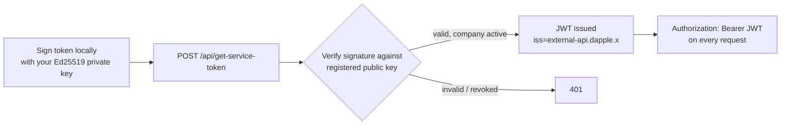

# Authentication

> **Audience:** Customer Integration Engineers · DevOps · Agents

The external surface authenticates customer companies with **Ed25519 service tokens**. You hold a private key; dapple holds your public key. You sign a short-lived token locally and exchange it for a JWT, then use that JWT as a bearer token on every request.

## The Exchange in Brief



### Exchanging for a JWT

```
POST https://external-api.dapple.x/api/get-service-token
Content-Type: application/json

{
  "token": "base64-encoded-128-byte-signed-token",
  "service_id": "your_company_prod_client"
}
```

The handler verifies the signature against your registered public key, looks up your company, refuses if the company is revoked, and issues a JWT signed with the **external surface's** signing key.

### What the JWT Carries

| Claim | Value | Notes |
|-------|-------|-------|
| `sub` | your company UUID | The load-bearing identity; every query is scoped to it |
| `company_slug` | human-readable slug | Decoration for logs/audit |
| `service_id` | your token's service id | Which of your tokens minted this JWT |
| `token_use` | `external_service` | Defends against cross-surface replay |
| `iss` | `external-api.dapple.x` | Defends against cross-surface replay |
| `exp` | expiry timestamp | Default 1 hour |

The JWT also resolves a `principal_id` that the surface stamps onto every journey and dispatch you create.

> **Use the JWT, not the signed token, on subsequent requests.** The signed token is only ever sent to `get-service-token`. Everything else uses `Authorization: Bearer <jwt>`.

## Cryptographic Isolation

The external surface loads only its own signing key. A JWT minted on the internal surface (`api.dapple.x`) fails signature verification here, and a JWT minted here fails on the internal surface. This is not an `aud`-claim convention — it is key separation, and verification fails before any claim is read. Even with the right `iss` and `token_use`, a JWT signed by the wrong key is rejected.

## Token Lifetime and Refresh

JWTs are short-lived (default 1 hour). Your client should refresh before expiry — the 50-minute mark is a good target. A `401` on a previously valid JWT usually means it expired; re-run the exchange.

## Onboarding (V1 Manual Flow)

Before you can exchange a token, dapple registers your company and your public key. V1 onboarding is a manual admin operation:

1. You generate an Ed25519 keypair on your side. The private key never leaves you.
2. dapple inserts your company row.
3. dapple registers one or more of your public keys with a `service_id` each.
4. dapple shares the `service_id`(s) with you.
5. You sign a token, exchange it, and use the returned JWT.

You may hold multiple `service_id`s (for example, separate production and staging clients). Each maps to one of your public keys; all belong to your single company.

## Revocation

dapple can revoke a single token (one `service_id`) or your entire company. Either revocation takes effect on the next token-exchange call — an already-issued JWT keeps working until it expires (typically within the hour). Plan rotations accordingly.

---

## The Full Auth Model

The canonical reference for the external service-token model — the database tables, the on-the-wire token structure, the exact claim semantics, and what these tokens can and cannot do — follows.

{{#include ../../_foundation/authentication/external-service-tokens.md}}
