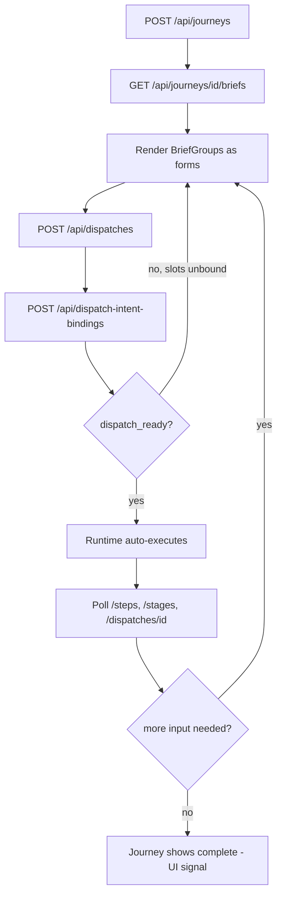

# Customer Runtime Flow

> **Audience:** Customer Integration Engineers · Backend Developers · Agents

This chapter walks a journey from creation to results on the external surface. Everything here is scoped to your company, and execution is automatic — you collect input and observe progress; you never drive tasks by hand.

## The Loop



This is an iterative loop, not a one-shot. An operator may cycle through debrief → dispatch → review multiple times before a journey is complete.

## Step 1: Create a Journey

You already hold the exact `guide_id` (guide version) and `playbook_id` (playbook version) you navigated to. Pass both — the backend validates the pair, it does not resolve "latest".

```
POST https://external-api.dapple.x/api/journeys
Authorization: Bearer <jwt>
Content-Type: application/json

{
  "objs": [
    {
      "name": "Resume Builder Session",
      "guide_id": "guide-version-uuid",
      "playbook_id": "playbook-version-uuid",
      "brief_pack_ids": ["briefpack-uuid"],
      "inference_profile_ids": ["profile-uuid"]
    }
  ]
}
```

**Response:**
```json
{
  "status": "success",
  "results": 1,
  "objs": [
    {
      "id": "journey-uuid",
      "name": "Resume Builder Session",
      "principal_id": "principal-uuid",
      "playbook_id": "playbook-version-uuid",
      "guide_id": "guide-version-uuid",
      "brief_packs": [ { "id": "briefpack-uuid" } ],
      "inference_profiles": [ { "id": "profile-uuid" } ],
      "created_at": "2024-01-22T10:30:00Z"
    }
  ]
}
```

Save `journey.id` — it is the central identifier for the session. `brief_pack_ids` is optional; when empty it is auto-derived from the pinned guide. A `guide_id`/`playbook_id` mismatch returns `400 GUIDE_PLAYBOOK_MISMATCH`; a guide outside your namespace returns `404`.

## Step 2: Fetch the Debrief

Get every brief for the journey in one request:

```
GET https://external-api.dapple.x/api/journeys/journey-uuid/briefs
Authorization: Bearer <jwt>
```

Each brief carries a `context` object with `brief_pack_id`, `brief_group_id`, and the group's name/title. **Group briefs by `brief_group_id`** and present each group as one atomic form section — a BriefGroup must be completed all-or-nothing.

> A debrief form-screen (a BriefGroup) is *not* the same as a playbook **step**. A step is a generate → pick → refine sub-interaction within a stage, surfaced via `/journeys/{id}/steps`.

## Step 3: Create a Dispatch

A dispatch is a batch of one-or-more steps. Submit a flat `steps[]`; the server groups them under their parent stage.

```
POST https://external-api.dapple.x/api/dispatches
Authorization: Bearer <jwt>
Content-Type: application/json

{
  "objs": [
    {
      "journey_id": "journey-uuid",
      "intent": { "user_goal": "Create professional resume" },
      "steps": [
        {
          "stage_step_id": "stage-step-uuid",
          "params": {},
          "tasks": [ { "step_task_id": "step-task-uuid" } ]
        }
      ]
    }
  ]
}
```

There is no top-level `stages` array on the request. To run a whole stage in one dispatch, include all of that stage's steps in `steps[]`.

## Step 4: Submit Bindings (this triggers execution)

Store the values the operator supplied. Each binding targets one `(dispatch_id, value_slot_id)` pair.

```
POST https://external-api.dapple.x/api/dispatch-intent-bindings
Authorization: Bearer <jwt>
Content-Type: application/json

{
  "objs": [
    {
      "dispatch_id": "dispatch-uuid",
      "value_slot_id": "name-slot-uuid",
      "text_items": [ { "value": "Jane Doe" } ],
      "value_meta": [
        { "ui_spec": { "widget": "text_input", "label": "Your Full Name" }, "producer": "name-input" }
      ]
    },
    {
      "dispatch_id": "dispatch-uuid",
      "value_slot_id": "email-slot-uuid",
      "text_items": [ { "value": "jane.doe@example.com" } ],
      "value_meta": [
        { "ui_spec": { "widget": "text_input", "label": "Email Address" }, "producer": "email-input" }
      ]
    }
  ]
}
```

Match the item array to the slot's `value_kind` (`text_items`, `int_items`, `number_items`, `bool_items`, `json_items`, `asset_items`). Items carry no `ordinal`; `asset_items` use `{ "asset_id": "…" }`. Omit unused arrays.

> **This is the execution trigger.** When the bindings make a dispatch `dispatch_ready` (every value slot its steps *expose* is now bound), the runtime spawns execution automatically. You do not POST a task attempt or drive tasks by hand.

## Step 5: Observe Progress

You do not start steps; you watch them. Poll these read-only endpoints.

**Per-step exposed-slot status** — the runtime expression of generate → pick → refine. Tells you which step is awaiting which slot:

```
GET https://external-api.dapple.x/api/journeys/journey-uuid/steps
```

```json
{
  "status": "success",
  "objs": [
    {
      "stage_step_id": "stage-step-uuid",
      "playbook_stage_id": "stage-uuid",
      "done": false,
      "exposed_slots": [
        {
          "value_slot_id": "name-slot-uuid", "name": "full-name", "value_kind": "text",
          "bound": false, "producer": "operator",
          "input": { "control_type": "text", "label_text": "Your Full Name" }
        },
        {
          "value_slot_id": "summary-slot-uuid", "name": "summary", "value_kind": "json",
          "bound": false, "producer": "computed"
        }
      ]
    }
  ]
}
```

Each slot's `producer` tells you what to do with it: render the `input` control and
collect a binding for `"operator"` slots; show a waiting state (and don't bind) for
`"computed"` slots, which the server fills after the step's task runs.

**Per-stage roll-up** — a stage is `done` when all of its steps are:

```
GET https://external-api.dapple.x/api/journeys/journey-uuid/stages
```

```json
{ "status": "success", "objs": [ { "playbook_stage_id": "stage-uuid", "done": false } ] }
```

**Dispatch status** — the server-derived nesting (`stages` → `steps` → `tasks`), each task carrying a `status`:

```
GET https://external-api.dapple.x/api/dispatches/dispatch-uuid
```

**Per-task runtime phase** — Running / Failed / Ok, read-only:

```
GET https://external-api.dapple.x/api/dispatches/dispatch-uuid/task_attempts
```

## Handling Missing Input

A `bound: false` slot only means the operator owes a value when its
`producer` is `"operator"`. A `bound: false` slot with `producer: "computed"`
is waiting on the **server**, not the operator — leave it alone and poll.

For an unbound **operator** slot:

1. Read `/journeys/{id}/steps` and find the unbound `value_slot_id` whose `producer` is `"operator"`.
2. Render its `input` spec (`control_type`, label/help/placeholder, `choices`) and collect the value.
3. POST the missing binding. Adding it flips the dispatch back to `dispatch_ready`, which re-spawns execution automatically. Latest-binding-wins: a later binding for the same slot supersedes an earlier one across dispatches.

For an unbound **computed** slot that stays `bound: false` after the producing
task reaches `ok`, check `/dispatches/{id}/task_attempts` → `computed_outputs`:
an `outcome` of `source_path_missing` / `type_mismatch` tells you the task ran
but couldn't produce the value (a guide-authoring issue), versus the server
simply still working.

## How Many Steps to Batch

A dispatch is a batch of one-or-more steps, and it only runs once every slot its steps expose is bound. So your real decision is how many steps to put in one dispatch's `steps[]`, and whether you have collected the bindings those steps need.

| Pattern | Batch | When |
|---------|-------|------|
| **Step-driven** | one step per dispatch | Best UX, early validation, fewer wasted tasks if the operator abandons |
| **Whole-stage** | all of a stage's steps | Simpler, fewer round-trips, operator sees the full picture first |
| **Operator-paced** | the steps whose slots are now satisfiable | Maximum flexibility, exploratory flows |

All three are supported; the API does not prefer one.

## Best Practices

**Do:**
- Group briefs by `brief_group_id` and render atomically.
- Store `journey.id` persistently — every later call needs it.
- Poll `/journeys/{id}/steps` and `/stages` to learn what the runtime is doing and which slots are unbound.
- Support iteration — add bindings; the dispatch re-readies and re-executes (latest-binding-wins).

**Don't:**
- Drive task execution by hand — there is no task-attempt write path on this surface.
- Treat journey completion as a gate — it is a UI-only signal; the only gate is `dispatch_ready`.
- Allow partial BriefGroup completion.
- Expose "Brief" terminology to the operator — say "form", "section", or "interview".
- Pass another company's `guide_id`/`playbook_id`/`journey_id` — it returns `404`, not the resource.

## Troubleshooting

| Symptom | Cause | Fix |
|---------|-------|-----|
| Dispatch never executes | Not `dispatch_ready` — a slot its steps expose is unbound | Read `/journeys/{id}/steps`, POST the missing bindings |
| `400 GUIDE_PLAYBOOK_MISMATCH` | `guide_id`/`playbook_id` inconsistent | Pass the exact pair you got from guide browse |
| `404` on a journey/dispatch/guide you expected | The id is foreign or unknown (no-leak 404) | Use ids your own company created; check the id |
| Duplicate binding rejected | A binding already exists for `(dispatch_id, value_slot_id)` | Use a new dispatch for new values (latest-wins resolves across dispatches) |
| Journey has no BriefPacks | Created without `brief_pack_ids` and the guide had none to derive | Pass `brief_pack_ids`, or ensure the pinned guide exposes one |
