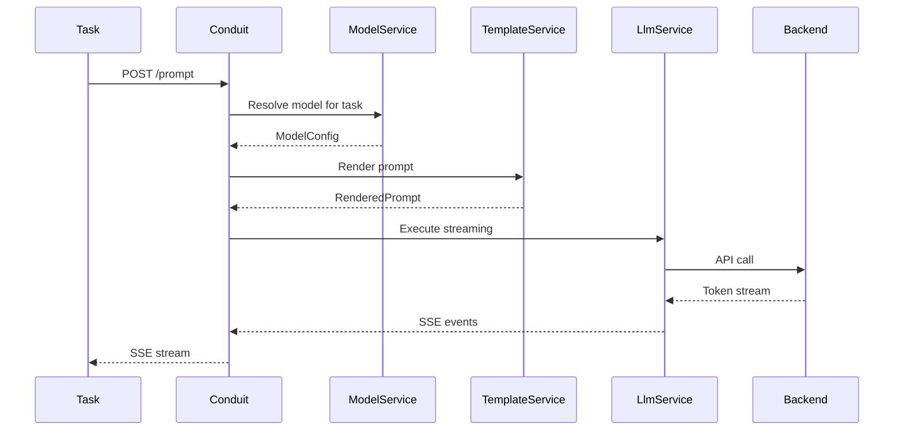

# Conduit Overview

> **Audience:** Backend Developers · Platform Engineers

The conduit (`dapple-prompt-conduit`) is the LLM routing layer that bridges Playbooks and LLM providers.

## What the Conduit Does

The conduit is a **provider-agnostic routing layer** that:

```mermaid
flowchart LR
    A[Task] --|PROMPT_ID| B[Conduit]
    B --> C[Template Service]
    C --> D[Model Service]
    D --> E{Router}
    E --|Anthropic| F[Claude]
    E --|Self-Hosted| G[Mistral]
    E --|Stub| H[Echo]
    F --> I[SSE Stream]
    G --> I
    H --> I
    I --> A
```

1. **Routes** author-selected prompts to configured LLM providers
2. **Renders** prompt templates using Handlebars with context data
3. **Resolves** model configuration based on lineage and provider
4. **Streams** responses via Server-Sent Events (SSE)
5. **Traces** all interactions for debugging and auditing
6. **Stores** responses in the database for replay and analysis

## Core Services

| Service | Responsibility |
|---------|----------------|
| `TemplateService` | Renders prompt templates with Handlebars |
| `ModelService` | Resolves model config for prompt execution |
| `OverlayService` | Determines visible value slots |
| `ContextService` | Fetches context data for attempts |
| `LlmService` | Routes to appropriate LLM backend |

## Model Resolution

The conduit uses the [Model Taxonomy](../../_foundation/concepts/model-taxonomy.md) to resolve models:

1. **Lineage** determines prompting style (e.g., `claude-3-5`, `vits`, `flan-t5`)
2. **Provider** determines where to send requests (e.g., `anthropic`, `self-hosted`)
3. **Tier** selects capability level (e.g., `sonnet`, `opus`, `ljspeech`)

```
ModelConfig {
    lineage_key: "claude-3-5",
    provider_key: "anthropic",
    tier: "sonnet",
    release: Some("20241022"),
    ...
}
```

## Request Flow



## Crate Structure

```
dapple-prompt-conduit/
├── src/
│   ├── handler/
│   │   └── prompt.rs              # Prompt execution endpoint
│   ├── service/
│   │   ├── context.rs             # Context data fetching
│   │   ├── model.rs               # Model config resolution (ModelService)
│   │   ├── template.rs            # Handlebars template rendering
│   │   ├── overlay.rs             # Slot visibility and semantic ranking
│   │   ├── llm/
│   │   │   ├── mod.rs             # LlmBackend trait, LlmService
│   │   │   ├── anthropic.rs       # Anthropic Claude via rig-core
│   │   │   ├── mistral.rs         # Local Mistral via Candle
│   │   │   └── stub.rs            # Testing stub
│   │   └── embedding/
│   │       ├── mod.rs             # EmbeddingBackend trait
│   │       └── modernbert.rs      # ModernBERT via Candle
│   └── error.rs
```

## Configuration

### Environment Variables

| Variable | Default | Description |
|----------|---------|-------------|
| `DATABASE_URL` | (required) | PostgreSQL connection |
| `CONDUIT_HOST` | `0.0.0.0` | Server bind address |
| `CONDUIT_PORT` | `8081` | Server port |
| `ONNX_MODEL_PATH` | `~/.cache/dapple-onnx` | Path to ONNX models (embedding, TTS) |

**ONNX Setup:** Before using embedding or TTS features, convert models:

```bash
nu assets/nu/k8s/convert_onnx_models.nu
```

See [TTS Service](./tts-service.md) for model details.

### Starting the Conduit

```bash
# Development with Anthropic
ANTHROPIC_API_KEY=sk-ant-... cargo run -p dapple-prompt-conduit

# Development with local Mistral
MISTRAL_ENABLED=true cargo run -p dapple-prompt-conduit

# Testing with stub only
cargo run -p dapple-prompt-conduit
```

## Inference Profiles and Guide Integration

Inference profiles are typically defined in guides via `:::inference_profile` directives and materialized during guide ingest. At dispatch time, the `ModelService` resolves the appropriate profile for a journey's prompt execution.

The profile carries system prompt, temperature, and max-token settings as Fluent attributes, making them localizable. See [Guide System: Materialization](../guide-system/materialization.md) for how profiles are created during ingest.

## Next Steps

- [LLM Backends](./llm-backends.md) — Backend selection and configuration
- [Template Rendering](./template-rendering.md) — Handlebars templates and context
- [Overlay System](./overlay-system.md) — Routing behavior configuration
