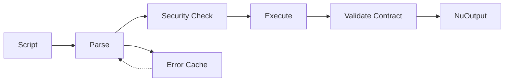

# StepEngine Internals

> **Audience:** Backend Developers · Platform Engineers

The StepEngine is the core execution environment for Nushell Tasks.

## Architecture



| Component | Purpose |
|-----------|---------|
| Parser | Compiles Nushell scripts to AST |
| Security Policy | Validates AST against allowed commands |
| Error Cache | Stores parse errors by script hash to avoid re-parsing |
| Contract Validator | Ensures output matches `{ payload, signals }` format |

## Execution Flow

1. **Script Hash Check** — If script was previously parsed with errors, return cached error
2. **Parse** — Convert script to AST using Nushell parser
3. **Security Validation** — Check AST against security policy
4. **Execute** — Run the parsed block with input data
5. **Contract Validation** — Verify output format

## Parse Cache

The StepEngine caches parse errors by script hash (SHA-256):

- Scripts that fail to parse are cached
- Subsequent executions of the same script return cached error immediately
- Cache is per-StepEngine instance (not persisted)

### Benefits

- Faster failure for known-bad scripts
- Reduced CPU overhead for repeated parse attempts
- Clear error messages without re-parsing

### Implementation

```rust
pub struct StepEngine {
    state: Arc<EngineState>,
    stack: Stack,
    parse_error_cache: HashMap<String, ParseError>,
}

impl StepEngine {
    pub fn execute(&mut self, script: &str, input: Value) -> Result<NuOutput, FlowError> {
        let script_hash = sha256(script);

        // Check cache first
        if let Some(cached_error) = self.parse_error_cache.get(&script_hash) {
            return Err(FlowError::Parse(cached_error.clone()));
        }

        // Parse script
        let block = match parse(script) {
            Ok(block) => block,
            Err(err) => {
                self.parse_error_cache.insert(script_hash, err.clone());
                return Err(FlowError::Parse(err));
            }
        };

        // Security check and execute...
    }
}
```

## Contract Validation

After execution, the StepEngine validates the output:

```rust
fn validate_contract(value: &Value) -> Result<NuOutput, FlowError> {
    // Must be a record
    let record = value.as_record()
        .ok_or(FlowError::ContractViolation("Script must return a record"))?;

    // Must have 'payload' field
    let payload = record.get("payload")
        .ok_or(FlowError::ContractViolation("Missing 'payload' field"))?;

    // 'signals' must be a record if present
    let signals = match record.get("signals") {
        Some(v) => v.as_record()
            .ok_or(FlowError::ContractViolation("'signals' must be a record"))?,
        None => Record::new(),
    };

    Ok(NuOutput { payload: payload.clone(), signals })
}
```

## Error Types

```rust
pub enum FlowError {
    /// Script failed to parse
    Parse(ParseError),

    /// Security policy violation
    Security(SecurityError),

    /// Runtime execution error
    Runtime(RuntimeError),

    /// Output doesn't match contract
    ContractViolation(String),
}
```

## Human Review Hooks

The StepEngine supports pausing execution for human review:

1. Runtime writes `checkpoint.json` with Step results
2. UI surfaces approve/reject controls
3. User reviews and approves
4. Runtime writes approval to `checkpoint.json`
5. Playbook proceeds to next Stage

### Checkpoint Format

```json
{
  "status": "pending_review",
  "step": "build-resume-step",
  "artifacts": ["resume.md", "resume.pdf"],
  "requested_at": "2024-01-15T10:30:00Z"
}
```

After approval:

```json
{
  "status": "approved",
  "step": "build-resume-step",
  "reviewer": "user@example.com",
  "approved_at": "2024-01-15T10:35:00Z",
  "notes": "Looks good, proceed."
}
```

## Best Practices

### Script Design

1. **Always return the contract** — `{ payload, signals }`
2. **Use signals for metadata** — Don't embed control data in payload
3. **Handle errors gracefully** — Write `error.json` before failing
4. **Keep scripts focused** — One task per script

### Performance

1. **Avoid external commands** — Use Nushell built-ins
2. **Stream large data** — Don't load everything into memory
3. **Leverage caching** — Parse cache helps repeated executions

### Debugging

1. **Use `debug` command** — Print intermediate values
2. **Check `DAPPLE_METADATA`** — Contains runtime context
3. **Write to log.jsonl** — Structured logs for tracing
