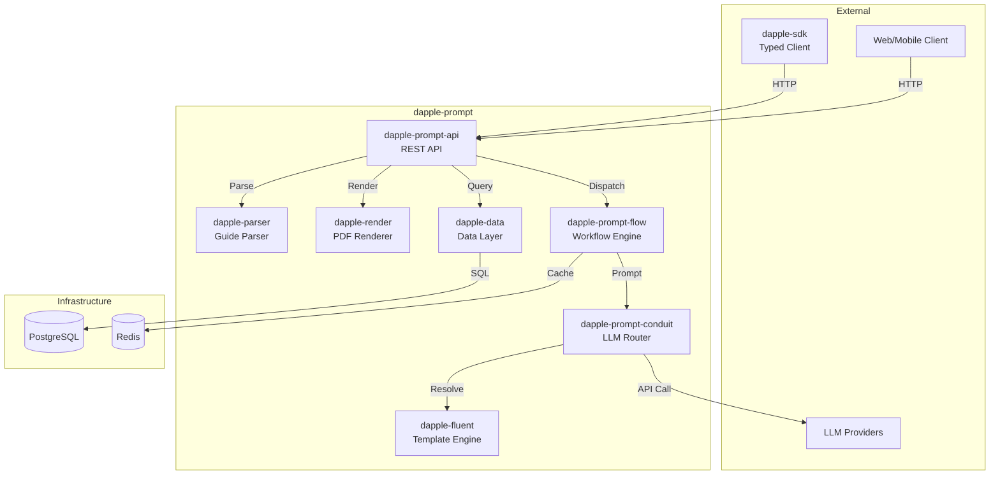
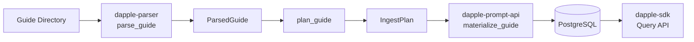

# Architecture Overview

> **Audience:** Backend Developers · Platform Engineers

This chapter provides a high-level view of the dapple-prompt platform architecture.

## System Components



## Crate Responsibilities

### dapple-prompt-api

The REST API service built with Axum.

| Component | Purpose |
|-----------|---------|
| Handlers (`src/handler/`) | Request processing, validation, response |
| Routes (`src/route/`) | URL routing, middleware |
| Schemas (`src/schema/`) | Request/response DTOs with schemars |

**Key patterns:**
- Handlers call `dapple-data` query functions
- Responses use public DTOs (never expose internal `id` fields)
- Batch operations via `{ "objs": [...] }` request format

### dapple-prompt-flow

The workflow execution engine.

| Component | Purpose |
|-----------|---------|
| StepEngine | Orchestrates task execution |
| NuExecutor | Runs Nushell scripts in sandbox |
| Dataflow | Manages data flow between steps |

**Key patterns:**
- Scripts must return `{ payload, signals }` record
- Artifacts pass between tasks via `IN_ARTIFACT` / `OUT_DIR`
- Sandboxed execution (no external commands, no `$env` mutation)
- A step's tasks run sequentially in authored order and **fail together** — the step stops on the first task failure (no log-and-continue)
- A step's computed outputs **publish once, together, at step completion** — a failed or vetoed step publishes nothing

### dapple-parser

The guide parsing and transformation crate.

| Component | Purpose |
|-----------|---------|
| Fence tokenizer (`fence.rs`) | `:::directive { attrs }` parsing |
| Block classifier (`block.rs`) | Tokens to `ParsedBlock` |
| Transform layer (`transform/`) | `ParsedGuide` to `IngestPlan` |

**Key patterns:**
- `parse_guide()` reads guide directories into `ParsedGuide` AST
- `plan_guide()` transforms to `IngestPlan` (pure, no DB access)
- Derived objects (playbooks, tasks, inference profiles) extracted from directive blocks

### dapple-render

The PDF rendering crate.

| Component | Purpose |
|-----------|---------|
| Tag filter (`filter.rs`) | Block selection by audience |
| Markdown renderer (`markdown.rs`) | Content to PDF elements |
| Style system (`style.rs`) | Branding configuration |

**Key patterns:**
- Render profiles define tag filter + style config
- Untagged blocks always included; tagged blocks filtered by profile
- Three branding styles: consumer, technical, internal

### dapple-sdk

The typed Rust SDK for the API.

| Component | Purpose |
|-----------|---------|
| `DappleClient` | Main client with resource accessors |
| Resource clients (`resource/`) | Typed sub-clients per endpoint |
| Code generation (`generated.rs`) | typify from OpenAPI spec |

**Key patterns:**
- Three auth methods: API token, Bearer JWT, Ed25519 service token
- Standard CRUD + non-standard endpoints (multipart ingest, binary render)
- `client.guides().ingest_from_dir()` for guide ingest

### dapple-prompt-conduit

The LLM routing and template service.

| Component | Purpose |
|-----------|---------|
| LlmBackend trait | Provider abstraction |
| TemplateEngine | Handlebars rendering |
| OverlaySystem | Runtime configuration |

**Key patterns:**
- Backend selection via `lineage_key` in ModelConfig
- Templates use Handlebars with context data
- Overlays override provider/model at multiple scopes

### dapple-data

The data access layer.

| Component | Purpose |
|-----------|---------|
| Models (`src/model/`) | Internal and DTO types |
| Queries (`src/query/`) | SQLx query functions |
| SQL Sources (`assets/sqlc/`) | `.sqlc` source files (edit these) |
| Generated SQL (`assets/.sql/`) | Compiled output from sql-composer |

**Key patterns:**
- Append-only (no UPDATE in normal flow)
- UNNEST with ordinality for batch inserts
- UUIDv7 primary keys, UUID FKs used directly in JOINs
- sql-composer pipeline: `.sqlc` sources -> `cargo sqlc compose` -> `.sql` output

## Guide Ingest Pipeline

The primary way objects enter the platform is through guide ingest. A guide directory is parsed, transformed, and materialized into database entities in a single transaction.



The `IngestPlan` carries all derived objects:

| Derived Object | Source Directive | Database Target |
|---------------|-----------------|-----------------|
| Playbook + Stages + Steps | `:::stage` / `:::step` | `rev.playbooks`, `rev.stages`, `rev.steps` |
| Tasks | `:::nushell` | `rev.tasks` |
| Brief Packs | `:::brief_pack` | `rev.brief_packs` |
| Inference Profiles | `:::inference_profile` | `rev.inference_profiles` |
| Fluent Messages | `locales/*.ftl` | `rev.fluent_messages` |
| Assets | Non-markdown files | `rev.assets`, `rev.chunks` |

For full details, see [Guide System Internals](../guide-system/parser-architecture.md).

## Data Flow Examples

### Creating a Journey

```
POST /api/journeys/
     ↓
JourneyHandler::create()
     ↓
dapple_data::query::journeys::insert_journeys()
     ↓
assets/.sql/journeys/insert_journeys.sql
     ↓
PostgreSQL INSERT ... RETURNING
     ↓
InsertedJourneyModel → Journey DTO
     ↓
JSON Response
```

### Executing a Dispatch

```
POST /api/dispatches/
     ↓
DispatchHandler::create()
     ↓
dapple_prompt_flow::StepEngine::execute()
     ↓
For each Task:
  NuExecutor::run(script)
       ↓
  Read IN_ARTIFACT, Write OUT_DIR
       ↓
  If prompt needed:
    dapple_prompt_conduit::execute()
         ↓
    LlmBackend::execute_streaming()
```

## Database Schema

The database uses multiple schemas for organization:

| Schema | Purpose |
|--------|---------|
| `web` | User-facing features, sessions, API tokens |
| `rev` | Analytics, billing, audit logs |
| `auth` | NextAuth.js tables |

**Key tables:**
- `web.journeys` — User workflow sessions
- `web.playbooks` — Workflow templates
- `rev.briefs` — Versioned brief definitions
- `rev.brief_groups` — Atomic brief bundles
- `rev.dispatches` — Workflow execution runs

## Configuration

### Environment Variables

| Variable | Service | Purpose |
|----------|---------|---------|
| `DAPPLE_PROMPT_DATABASE_URL` | All | PostgreSQL connection |
| `DAPPLE_PROMPT_API_SIGNING_KEY` | API | JWT signing |
| `ANTHROPIC_API_KEY` | Conduit | Claude API access |
| `MISTRAL_ENABLED` | Conduit | Enable local Mistral |

### Feature Flags

Conduit LLM backends are enabled via Cargo features:
- `anthropic` — Anthropic Claude (default)
- `mistral` — Local Mistral via Candle
- `cuda` / `metal` — GPU acceleration

## Next Steps

- [Flow Engine Overview](../flow/overview.md) — Detailed execution model
- [Conduit Overview](../conduit/overview.md) — LLM routing details
- [Data Layer Patterns](../data-layer/query-patterns.md) — SQL conventions
