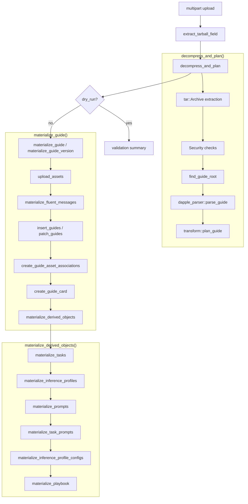

# Materialization

> **Audience:** Backend Developers -- Platform Engineers

> **Note:** The `POST /api/shared-content/ingest` endpoint and the
> `plan_shared_content()` materialization path described later in this chapter
> were **removed** during the path-layer refactor. The handler, parser
> pipeline, SDK client, and `rev.guide_shared_refs` / `rev.shared_content_objects`
> tables are gone. Shared content is deferred to V2+; sections referencing it
> are preserved for design context but do not describe current behavior.

Materialization is the process that takes an `IngestPlan` produced by the
transform layer and writes all derived entities to the database within a single
transaction. This chapter covers the API endpoints, tarball handling, the
materialization pipeline, and deduplication strategy.

## Endpoints

| Method | Path | Purpose |
|--------|------|---------|
| `POST` | `/api/guides/ingest` | Create a new guide from a tarball |
| `PATCH` | `/api/guides/{path_object_id}/ingest` | Create a new version of an existing guide |
| `POST` | `/api/shared-content/ingest?scope=<scope>` | Ingest shared content library |

Both guide endpoints accept `multipart/form-data` with a `file` field containing
a `.tar.gz` archive.

### Query Parameters

| Parameter | Type | Default | Description |
|-----------|------|---------|-------------|
| `dry_run` | `bool` | `false` | Parse and validate only; return summary without materializing |
| `source_path` | `Option<String>` | `None` | Override the guide's `source_path` metadata field |

## Pipeline Overview



## Tarball Extraction

### extract_tarball_field()

Reads the `file` field from the multipart request. Enforces a **50 MB maximum**
tarball size. Returns the raw bytes for decompression.

### Security Checks

The decompression step performs two security checks on every tarball entry:

1. **Symlink rejection** -- Entries of type `Symlink` or `Link` are rejected
   with an error suggesting `tar czh` (the `--dereference` flag).
2. **Path traversal rejection** -- Any entry containing a `..` component is
   rejected.

### find_guide_root()

After extraction, the handler locates the guide root using this heuristic:

1. If `guide.toml` or `book.toml` exists at the extraction root, use the root.
2. Scan top-level subdirectories for one that contains `guide.toml` or
   `book.toml`.
3. If there is exactly one subdirectory, recurse one level into it.
4. If the single subdirectory has `SUMMARY.md` (at root or `src/`), use it.
5. Otherwise, return an error.

## Dry-Run Mode

When `dry_run=true`, the endpoint returns a validation summary without touching
the database:

```json
{
  "valid": true,
  "errors": [],
  "warnings": ["..."],
  "summary": {
    "title": "Essay Writing Guide",
    "chapters": 5,
    "blocks": 23,
    "assets": 3,
    "derived_playbook_stages": 4,
    "derived_brief_packs": 1,
    "derived_tasks": 6,
    "derived_inference_profiles": 2,
    "deprecation_level": null,
    "deprecation_reason": null
  }
}
```

## Materialization Steps

### 1. Asset Upload

Assets go through the draft/chunk/finalize pipeline:

```
for each AssetFileEntry:
    1. insert_drafts() -> draft_object_id
    2. Split data into 256 KB chunks
    3. insert_draft_chunks() for each chunk
    4. finalize_draft() -> (asset_object_id, asset_id, path_object_id)
```

The result is a `HashMap<relative_path, UploadedAsset>` used for downstream
association. Asset kind (`image`, `audio`, `video`, `document`, `binary`) is
inferred from the MIME type.

### 2. Fluent Message Materialization

For each `FluentMessageSet` in the plan:

1. Batch-query existing messages by name from the database.
2. If a message with the same name exists, reuse its internal ID (no duplicate
   insert).
3. For new messages, insert into `rev.fluent_messages` with per-locale bodies.
4. Return a `HashMap<message_key, internal_id>` for block association.

This reuse-or-create strategy means that the same Fluent message key shared
across multiple guides is stored once.

### 3. Guide Insert (POST) / Guide Patch (PATCH)

**POST** (`insert_guides`): Creates the full entity graph atomically via a CTE:

- `rev.object_paths` -- New path for the guide
- `rev.guide_path_details` -- Path metadata (title, slug, etc.)
- `rev.versioned_objects` -- Versioned object with version numbers
- `rev.guides` -- The guide record
- `rev.guide_chapters` -- All chapters
- `rev.guide_blocks` -- All blocks within chapters
- `rev.guide_block_tags` -- Tag associations for blocks

**PATCH** (`patch_guides`): Creates a new version under an existing path. The
`path_object_id` is provided in the URL. Version numbers increment the patch
component by default (from the guide.toml `version` field or `0.0.1` fallback).

Both operations receive a `InsertGuideWithChildrenArgs` struct:

```rust
pub struct InsertGuideWithChildrenArgs {
    pub title: String,
    pub description: Option<String>,
    pub author: Option<String>,
    pub classification: Option<String>,
    pub source_path: Option<String>,
    pub version_major: Option<i32>,
    pub version_minor: Option<i32>,
    pub version_patch: Option<i32>,
    pub chapters: Vec<InsertGuideChapterWithBlocksArgs>,
    pub deprecation_level_key: Option<String>,
    pub deprecation_reason: Option<String>,
}
```

Each block carries an optional `fluent_message_id` that links to the Fluent
message materialized in step 2. The link is set when the block has `content:
None` and a `name` matching a message key.

### 4. Guide-Asset Associations

`insert_guide_assets()` creates rows in `rev.guide_assets` linking the guide to
its uploaded assets. Each association carries:

- `guide_id` -- Internal guide ID
- `asset_id` -- Internal asset ID
- `role` -- `"card_image"` if the path matches the `[card].image` field,
  otherwise `"attachment"`
- `relative_path` -- The original path within the guide directory

### 5. Guide Card

If the `IngestPlan` has a `CardDef`, `insert_guide_cards()` creates a row in
`rev.guide_cards` with:

- `guide_id` -- Internal guide ID
- `card_image_asset_id` -- Resolved from the asset map if `card.image` is set
- `color`, `accent` -- From the `CardDef`
- `subtitle`, `category` -- `None` (these are Fluent attributes now)

### 6. Derived Object Materialization

Objects are created in dependency order:

```
Tasks -> Inference Profiles -> Prompts -> Task-Prompts -> IP Configs -> Playbook
```

#### Tasks

For each `TaskDef`:

1. Compute slug via `dapple_data::slugify()` and parse the version tuple.
2. Batch-query existing tasks by `(slug, major, minor, patch)`.
3. Reuse existing tasks where a match is found.
4. Insert only new tasks via `insert_tasks()`.
5. Return a `HashMap<task_name, task_object_id>` for playbook step linkage.

```rust
let task_args = InsertTaskArgs {
    names: vec![...],
    descriptions: vec![...],
    functions: vec!["nushell".to_string(), ...],
    function_inputs: vec![json!({ "script": "..." }), ...],
    version_majors: vec![...],
    version_minors: vec![...],
    version_patches: vec![...],
};
```

#### Inference Profiles

For each `InferenceProfileDef`:

1. Query existing profiles by name.
2. Reuse existing profiles where a match is found.
3. Insert only new profiles via `insert_inference_profiles()`.
4. Return both `Vec<Uuid>` (object IDs) and `Vec<(String, i64)>` (name-to-internal-ID pairs for config wiring).

```rust
let ip_args = InsertInferenceProfileArgs {
    names: vec![...],
    descriptions: vec![None, ...],
};
```

#### Prompts

One Prompt entity is created per `:::inference_profile` block:

1. The prompt name matches the inference profile name.
2. Name-based deduplication: if a prompt with the same name exists, it is reused.
3. New prompts are linked to their Fluent messages via `rev.prompt_fluent_messages`.
4. Return a map from profile name to `PromptRef { object_id, internal_id, path_object_id }`.

#### Task-Prompt Links

A cross-product of all materialized tasks and all materialized prompts:

1. Collect all task object IDs and all prompt refs.
2. Create rows in `rev.task_prompts` linking every task to every prompt.
3. This enables any task within the playbook to use any profile's prompt at runtime.

#### Inference Profile Configs

For each inference profile with model selection Fluent attributes:

1. Extract `.lineage`, `.tier`, and `.release` from the profile's `FluentMessageSet` attributes.
2. Query `rev.model_releases` to resolve the `model_release_id` from the lineage/tier/release tuple.
3. Create `rev.inference_profile_configs` entries linking `inference_profile_id` → `prompt_path_object_id` → `model_release_id`.
4. If the Fluent attributes are absent or the model release is not found, the profile is created without a config entry (a warning is logged).

#### Playbook

The most involved materialization, using three levels of slug+version dedup:

1. **Playbook level** -- Check if slug+version exists. If so, return its
   `object_id` immediately. Also check for any-version match (name uniqueness
   constraint on `rev.playbook_path_details`).
2. **Step level** -- Batch-query all steps across all stages by slug+version.
   Reuse existing, insert new. Link steps to tasks via `task_name_to_object_id`.
3. **Stage level** -- Batch-query stages by slug+version. Reuse existing, insert
   new.
4. **Create playbook** -- `insert_playbooks()` with the stage/step/task graph.

## Deduplication Strategy

All derived objects use **slug+version uniqueness** for idempotent ingest:

```
slug = dapple_data::slugify(name)
version = (major, minor, patch) from guide.toml or block attributes
```

If an object at the same `(slug, major, minor, patch)` already exists in the
database, the materialization reuses the existing `object_id` instead of
inserting a duplicate. This makes re-ingesting the same guide version safe.

## Shared Content Materialization

`POST /api/shared-content/ingest?scope=<common|internal>` follows the same
tarball extraction flow but reads `shared.toml` instead of `guide.toml`.

The handler calls `parse_shared_content()` and `plan_shared_content()`, then
materializes only:

- Tasks
- Inference profiles
- Fluent messages
- Asset files

Playbooks, brief packs, and refs produce warnings and are excluded.

The `ref_key` (`"{scope}/{name}"`) is recorded in `rev.shared_content_refs` for
guide cross-reference resolution.

## SDK Integration

The Rust SDK provides convenience methods that handle tarball creation and
upload:

```rust
// Ingest a new guide from a local directory
let result = client
    .guides()
    .ingest_from_dir("./my-guide/")
    .await?;

// Ingest a new version of an existing guide
let result = client
    .guides()
    .ingest_version_from_dir("./my-guide/", path_object_id)
    .await?;

// Ingest shared content
let result = client
    .shared_content()
    .ingest_from_dir("./my-shared/", "common")
    .await?;
```

## Source Files

| File | Purpose |
|------|---------|
| `crates/dapple-prompt-api/src/handler/guide_ingest.rs` | POST and PATCH handlers, tarball extraction, materialization |
| `crates/dapple-prompt-api/src/handler/shared_ingest.rs` | Shared content ingest handler |
| `crates/dapple-prompt-api/src/schema/guide_ingest.rs` | Request/response schemas |
| `crates/dapple-parser/src/transform/mod.rs` | `IngestPlan` definition |

## Next Steps

- [Data Model](./data-model.md) -- Database schema for the guide system
- [Transform Layer](./transform-layer.md) -- How `ParsedGuide` becomes an `IngestPlan`
- [Render Pipeline](./render-pipeline.md) -- How guides are rendered to PDF
