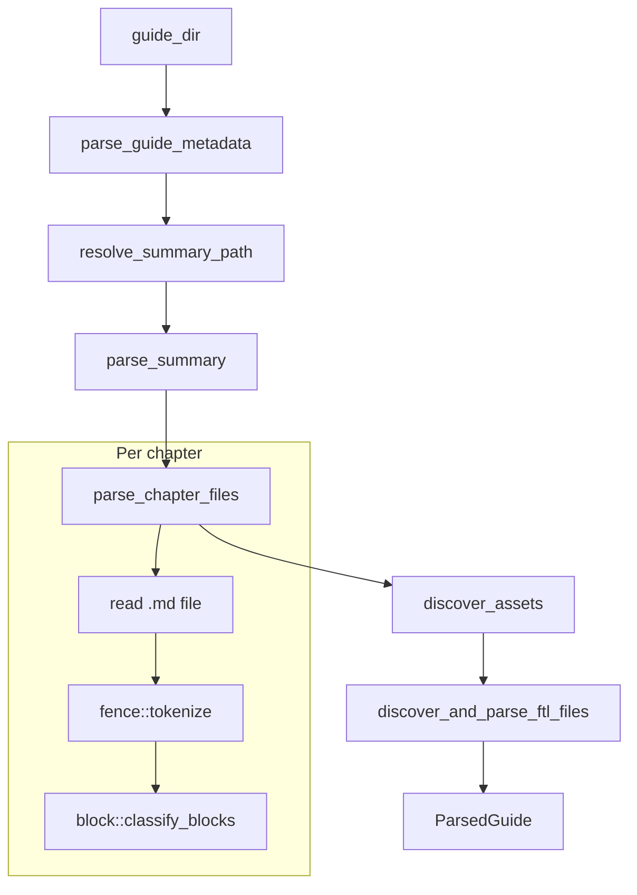

# Parser Architecture

> **Audience:** Backend Developers -- Platform Engineers

> **Note:** Sections below that describe shared-content parsing
> (`parse_shared_content()`, `SharedContentPlan`, `MissingSharedToml`,
> `InvalidSharedToml`, `dapple-parser/src/shared.rs`) describe a pipeline that
> was **removed** during the path-layer refactor. The `:::ref` directive is
> still parsed but currently has no materialization target. Shared content is
> deferred to V2+ and will be redesigned with a proper
> `rev.shared_content_path_details` table when it returns. Treat shared-content
> sections in this chapter as historical/design context, not as a current
> implementation reference.

This chapter documents the internals of `dapple-parser`, the crate responsible for
reading a guide directory and producing a structured `ParsedGuide` AST. Everything
here describes parse-time behavior; the transform and materialization phases are
covered in subsequent chapters.

## Crate Layout

```
crates/dapple-parser/src/
├── lib.rs          # parse_guide() entry point, KNOWN_DIRECTIVES
├── fence.rs        # Fence tokenizer (:::directive { attrs })
├── block.rs        # Block classifier (tokens -> ParsedBlock)
├── attrs.rs        # Attribute parser (key-value from { ... })
├── ftl.rs          # Fluent .ftl file discovery and parsing
├── summary.rs      # SUMMARY.md parser
├── guide_toml.rs   # guide.toml metadata parser
├── canonical.rs    # Canonical manifest (canonical.toml) parser
├── shared.rs       # shared.toml parser for shared content libraries
├── types.rs        # ParsedGuide, ParsedBlock, FluentMessageDef, etc.
├── error.rs        # ParseError types
└── transform/      # Pure transform layer (separate chapter)
```

## Entry Point: `parse_guide()`

`parse_guide()` in `lib.rs` orchestrates the entire parse phase. The steps execute
sequentially and the function returns a `ParsedGuide` on success.

```
parse_guide(guide_dir: &Path) -> Result<ParsedGuide, ParseError>
```

### Step-by-step flow

1. **Parse metadata** -- Read `guide.toml` (preferred) or `book.toml` (legacy
   fallback). Extract title, description, author, classification, version,
   optional `[card]` section, and optional `[deprecation]` section.
2. **Resolve SUMMARY.md** -- Look at the guide root first
   (`{guide_dir}/SUMMARY.md`), then fall back to the legacy mdBook convention
   (`{guide_dir}/src/SUMMARY.md`).
3. **Parse SUMMARY.md** -- Line-by-line extraction of markdown links
   `[Title](./path.md)`, computing depth from indentation (2 spaces per level)
   and parent indices via backward scan.
4. **Parse chapter files** -- For each chapter stub, read the `.md` file,
   tokenize with `fence::tokenize()`, then classify blocks with
   `block::classify_blocks()`.
5. **Discover asset files** -- Walk the guide directory tree collecting non-`.md`,
   non-`.toml`, non-`.ftl` files. Hidden files and the `locales/` directory are
   excluded.
6. **Discover and parse Fluent files** -- Scan `locales/` for `.ftl` files, parse
   each with `fluent-syntax`, and extract `FluentMessageDef` entries keyed by
   locale tag.



## KNOWN_DIRECTIVES

The parser recognizes these directive type strings:

```rust
pub const KNOWN_DIRECTIVES: &[&str] = &[
    "prose",
    "stage",
    "step",
    "nushell",
    "brief_pack",
    "brief-pack",
    "inference_profile",
    "inference-profile",
    "ref",
    "block",
];
```

Hyphenated forms (`brief-pack`, `inference-profile`) are accepted at parse time
and normalized to underscored forms (`brief_pack`, `inference_profile`) by the
block classifier.

## Fence Tokenizer (`fence.rs`)

The tokenizer is a line-by-line scanner that converts raw markdown into a flat
stream of `FenceToken` values.

### FenceToken enum

```rust
pub enum FenceToken {
    Open { directive: String, raw_attrs: String, line: usize },
    Close { line: usize },
    Content { text: String, line: usize },
    Prose { text: String, line: usize },
}
```

### Scanning rules

| Input pattern | Token produced | Notes |
|--------------|---------------|-------|
| `:::directive { attrs }` | `Open` | Pushed onto nesting stack |
| `:::` (bare or with comment) | `Close` | Pops nesting stack |
| Line inside an open fence | `Content` | Appended to current block |
| Line outside any fence | `Prose` | Free-standing markdown |
| Triple backtick (`` ``` ``) | Toggles code-block state | Code block content passes through opaquely |

**Nesting** is tracked with a stack of `(directive_name, open_line)` tuples.
When a `Close` token is emitted, the top entry is popped. Stray closing fences
(when the stack is empty) become `Prose` tokens instead of producing an error.

**Code block passthrough** prevents the tokenizer from interpreting `:::` patterns
inside fenced code blocks. The toggle flips on the first triple backtick and
flips back on the next.

**Error detection:** If the token stream ends with a non-empty stack, the
tokenizer returns `ParseError::UnclosedFence` with the opening line number.

## Block Classifier (`block.rs`)

`classify_blocks()` takes the flat `FenceToken` vector and converts it into a
hierarchical `Vec<ParsedBlock>` tree.

### Algorithm

1. Maintain a result vector, a prose buffer, and a block stack.
2. On `Prose` tokens: accumulate into the prose buffer.
3. On `Open` tokens: flush prose buffer as a prose block, parse attributes, push
   a new `ParsedBlock` onto the stack.
4. On `Content` tokens: append text to the block at the top of the stack.
5. On `Close` tokens: pop the top block. If the stack is non-empty, attach as a
   child of the new top. Otherwise, push to the result vector.

### Directive normalization

```rust
fn normalize_directive_type(directive: &str) -> String {
    directive.replace('-', "_")
}
```

This means `:::brief-pack` and `:::brief_pack` produce identical `ParsedBlock`
values with `directive_type = "brief_pack"`.

### Prose flushing

Prose buffers are flushed when a directive boundary is encountered (an `Open` or
the end of input). Empty or whitespace-only buffers are discarded. Non-empty
prose is wrapped in a `ParsedBlock` with `directive_type = "prose"` and attached
either to the current open block (as a child) or to the top-level result.

## Attribute Parser (`attrs.rs`)

`parse_attributes()` handles the `{ key: "value", tags: [agent, product] }`
metadata that follows a directive name.

### Strategy

1. Try JSON parsing first (`serde_json::from_str`).
2. If JSON fails, normalize the YAML-like syntax to valid JSON by quoting
   unquoted keys and string values.
3. Booleans (`true`, `false`), `null`, and numeric values are left unquoted.
4. Array items inside `[...]` follow the same quoting rules.

### Extracted fields

| Function | Returns | Purpose |
|----------|---------|---------|
| `extract_name()` | `Option<String>` | Block name for derived object extraction |
| `extract_tags()` | `Vec<String>` | Tag keys for render filtering |
| `extract_ref()` | `Option<String>` | Shared content reference path |
| `extract_version()` | `Option<String>` | Semantic version for idempotent dedup |

`name` and `ref` are mutually exclusive. If both are present, the block
classifier returns `ParseError::RefAndNameConflict`.

## Fluent File Discovery (`ftl.rs`)

`discover_and_parse_ftl_files()` scans the `locales/` subdirectory of the guide
root.

### Process

1. If `locales/` does not exist, return an empty map.
2. Read all `.ftl` files. The locale tag is derived from the file stem (e.g.,
   `en` from `en.ftl`, `pt-BR` from `pt-BR.ftl`).
3. Parse each file with `fluent_syntax::parser::parse()`.
4. Walk the AST entries, extracting only `Message` entries (terms prefixed with
   `-` are skipped).
5. For each message, extract the key, body text, and attributes (`.key = value`
   pairs).

### FluentMessageDef

```rust
pub struct FluentMessageDef {
    pub key: String,
    pub body: String,
    pub attributes: HashMap<String, String>,
}
```

**Placeable handling:** Variable references (`$var`), term references (`-term`),
and message references are serialized as `{ expression }` strings. Full Fluent
runtime resolution is deferred to the conduit layer.

## SUMMARY.md Parser (`summary.rs`)

`parse_summary()` reads the SUMMARY.md line by line and produces a flat vector
of `ParsedChapterStub` values.

### Rules

- Blank lines and `# Section Header` lines are skipped (section headers are
  visual separators, not chapters).
- Lines containing `[Title](path)` markdown links are extracted.
- Depth is computed from leading whitespace: 2 spaces per indent level.
- Parent index is found by walking backwards through the stub list for the
  nearest entry at `depth - 1`.

```rust
pub struct ParsedChapterStub {
    pub title: String,
    pub source_file: String,
    pub depth: usize,
    pub parent_index: Option<usize>,
}
```

## guide.toml Parser (`guide_toml.rs`)

`parse_guide_toml()` deserializes the TOML into a `GuideToml` struct using serde.

### GuideToml fields

| Field | Type | Required | Notes |
|-------|------|----------|-------|
| `title` | `String` | Yes | Guide title |
| `description` | `Option<String>` | No | Short description |
| `author` | `Option<String>` | No | Author name |
| `classification` | `Option<String>` | No | e.g., "tutorial", "workflow" |
| `version` | `Option<String>` | No | Validated as semver when present |
| `card` | `Option<GuideCardToml>` | No | Visual card properties |
| `deprecation` | `Option<GuideDeprecationToml>` | No | Deprecation state |

### Card section

The `[card]` section carries only locale-independent visual properties:

```toml
[card]
image = "assets/images/card.jpg"
color = "#2D6A4F"
accent = "#95D5B2"
```

Subtitle and category are Fluent attributes on the brief-pack message, not TOML
fields. Legacy fields (`subtitle`, `category`, `locale`) are silently ignored.

### Deprecation section

```toml
[deprecation]
level = "deprecated"       # "deprecated", "retired", or "quarantined"
reason = "Replaced by v2"  # optional
```

The level `"active"` is rejected -- omit the section for active guides.

### Legacy fallback

If `guide.toml` does not exist, the parser falls back to `book.toml` and
extracts only the `title` field via line-by-line string parsing. A deprecation
warning is logged.

## ParsedGuide Output

The final output of the parse phase:

```rust
pub struct ParsedGuide {
    pub title: String,
    pub metadata: GuideMetadata,
    pub chapters: Vec<ParsedChapter>,
    pub asset_paths: Vec<String>,
    pub locales: HashMap<String, Vec<FluentMessageDef>>,
}
```

Each `ParsedChapter` contains a `Vec<ParsedBlock>` with the full block
hierarchy. Each `ParsedBlock` carries:

```rust
pub struct ParsedBlock {
    pub directive_type: String,
    pub name: Option<String>,
    pub content: String,
    pub attributes: serde_json::Value,
    pub tags: Vec<String>,
    pub source_line: usize,
    pub children: Vec<ParsedBlock>,
    pub ref_path: Option<String>,
}
```

## Shared Content Parsing

`parse_shared_content()` follows a similar flow but reads `shared.toml` instead
of `guide.toml`, makes SUMMARY.md optional, and returns a `(ParsedGuide,
SharedToml)` tuple. The downstream transform uses `plan_shared_content()` to
filter to tasks, inference profiles, and Fluent messages only.

## Error Types

All parse-time errors are variants of `ParseError`:

| Variant | Trigger |
|---------|---------|
| `MissingGuideToml` | Neither `guide.toml` nor `book.toml` found |
| `MissingSummary` | No `SUMMARY.md` at root or `src/` |
| `UnclosedFence` | Fence directive not closed before EOF |
| `InvalidAttributes` | Attribute syntax cannot be parsed |
| `InvalidGuideToml` | TOML parse failure or invalid semver/deprecation |
| `InvalidFtlFile` | Fluent syntax error in a `.ftl` file |
| `RefAndNameConflict` | Block has both `name` and `ref` attributes |
| `MissingSharedToml` | Shared content dir missing `shared.toml` |
| `InvalidSharedToml` | Bad `shared.toml` content or invalid semver |
| `InvalidCanonicalToml` | Bad `canonical.toml` content, scope, env, or semver |

## Next Steps

- [Transform Layer](./transform-layer.md) -- How `ParsedGuide` becomes an `IngestPlan`
- [Materialization](./materialization.md) -- How the API handler writes the plan to the database
- [Extending the Guide System](./extending.md) -- Adding new directives and derived objects
