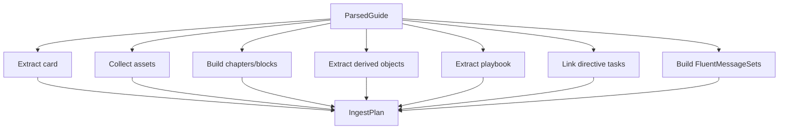

# Transform Layer

> **Audience:** Backend Developers -- Platform Engineers

The transform layer is the pure-function bridge between parsing and
materialization. It takes a `ParsedGuide` AST and produces an `IngestPlan` that
contains everything needed to write the guide and all derived objects to the
database in a single transaction. The transform has no database access -- it is
deterministic and side-effect free.

## Entry Point: `plan_guide()`

```rust
pub fn plan_guide(
    parsed: &ParsedGuide,
    guide_dir: &Path,
) -> Result<IngestPlan, ParseError>
```

The `guide_dir` parameter is needed only so asset file bytes can be read from
disk. All other inputs come from the `ParsedGuide` produced by the parser.

### Step-by-step flow

1. **Extract card metadata** -- Map the `[card]` section from `GuideMetadata`
   into a `CardDef`. Only locale-independent properties (image path, color,
   accent) are carried; subtitle and category live in Fluent attributes.

2. **Collect asset files** -- Read bytes from disk for every path in
   `parsed.asset_paths`. Infer MIME type from file extension. Missing files
   produce a warning, not an error.

3. **Build ChapterDef/BlockDef tree** -- Map each `ParsedChapter` and its blocks
   into `ChapterDef` and `BlockDef` values. Fluent-backed blocks (`prose`,
   `stage`, `step`, `brief_pack`, `inference_profile`, `block`) have their
   `content` set to `None` unless they contain non-empty markdown fallback text.
   Inline blocks (`nushell`, `ref`) always retain their `content`.

4. **Extract derived objects** -- Walk all blocks across all chapters. For each
   block, match on `directive_type` and call the corresponding extractor:
   - `"nushell"` -> `task::extract_task()` -> `TaskDef`
   - `"brief_pack"` -> `brief_pack::extract_brief_pack()` -> `BriefPackDef`
   - `"inference_profile"` -> `extract_inference_profile()` -> `InferenceProfileDef`
   - `"ref"` -> `extract_ref()` -> `RefDef`
   - Blocks with `ref_path` -> `SharedRefDef` (instead of a derived object)

5. **Extract playbook** -- `playbook::extract_playbook()` walks the chapter
   tree looking for `:::stage` blocks containing `:::step` children. Produces
   a `PlaybookDef` with ordered `StageDef` and `StepDef` values.

6. **Link directive tasks** -- `task::link_directive_tasks()` validates that
   nushell blocks with `role: "directive"` reference valid step or stage names
   in the playbook. Produces warnings for unresolved references.

7. **Build FluentMessageSets** -- Group `FluentMessageDef` entries by message
   key across all locales. Each key produces one `FluentMessageSet` with
   per-locale bodies and attributes.



## IngestPlan Structure

```rust
pub struct IngestPlan {
    pub title: String,
    pub description: Option<String>,
    pub author: Option<String>,
    pub classification: Option<String>,
    pub version: Option<String>,
    pub source_path: Option<String>,

    pub chapters: Vec<ChapterDef>,
    pub card: Option<CardDef>,
    pub asset_files: Vec<AssetFileEntry>,

    pub derived_brief_packs: Vec<BriefPackDef>,
    pub derived_playbook: Option<PlaybookDef>,
    pub derived_tasks: Vec<TaskDef>,
    pub derived_inference_profiles: Vec<InferenceProfileDef>,
    pub derived_refs: Vec<RefDef>,
    pub shared_refs: Vec<SharedRefDef>,

    pub fluent_messages: HashMap<String, FluentMessageSet>,

    pub deprecation_level: Option<String>,
    pub deprecation_reason: Option<String>,
    pub warnings: Vec<String>,
}
```

### Key invariant

There is **no locale field** on the `IngestPlan`. The guide structure is
locale-independent. All localizable text is carried inside `FluentMessageSet`
entries.

## Chapter and Block Definitions

```rust
pub struct ChapterDef {
    pub title: String,
    pub source_file: String,
    pub parent_index: Option<usize>,
    pub blocks: Vec<BlockDef>,
}

pub struct BlockDef {
    pub directive_type: String,
    pub name: Option<String>,
    pub content: Option<String>,   // None for Fluent-backed blocks
    pub attributes: serde_json::Value,
    pub tags: Vec<String>,
}
```

### Content rules

| Directive type | `content` value | Rationale |
|---------------|----------------|-----------|
| `nushell` | `Some(script)` | Code is not localized |
| `ref` | `Some(reference)` | Structural cross-reference, not localized |
| `prose` | `None` (or `Some` if non-empty fallback) | Localizable narrative text |
| `stage` | `None` (or `Some` if non-empty fallback) | Localizable description |
| `step` | `None` (or `Some` if non-empty fallback) | Localizable description |
| `brief_pack` | `None` (or `Some` if non-empty fallback) | Localizable pack content |
| `inference_profile` | `None` (or `Some` if non-empty fallback) | Localizable prompts |
| `block` | `None` (or `Some` if non-empty fallback) | Localizable generic content |

## Derived Object Types

### PlaybookDef

Extracted by `playbook::extract_playbook()` from the `:::stage`/`:::step` block
hierarchy.

```rust
pub struct PlaybookDef {
    pub name: String,               // From guide title
    pub version: Option<String>,    // From guide.toml version
    pub stages: Vec<StageDef>,
}

pub struct StageDef {
    pub name: String,
    pub version: Option<String>,
    pub flow_control: Option<serde_json::Value>,
    pub steps: Vec<StepDef>,
    pub source_block_index: BlockIndex,
}

pub struct StepDef {
    pub name: String,
    pub version: Option<String>,
    pub flow_control: Option<serde_json::Value>,
    pub task_refs: Vec<String>,     // Names of nushell blocks to link, in execution order
    pub source_block_index: BlockIndex,
}
```

A Step links to **one or more** Tasks: the ordered `task_refs` become rows in
`rev.step_tasks` (with an `ord` column preserving execution order). Multiple
tasks per step is the norm — the Tasks of a step run sequentially and fail
together (see [Core Execution Model](../../_foundation/concepts/core-execution-model.md)).

### TaskDef

Extracted by `task::extract_task()` from `:::nushell` blocks.

```rust
pub struct TaskDef {
    pub name: String,
    pub version: Option<String>,
    pub script: String,             // Raw nushell script
    pub role: String,               // "default" or "directive"
    pub target: Option<String>,     // Step/stage name for directive role
    pub source_block_index: BlockIndex,
}
```

### BriefPackDef

Extracted by `brief_pack::extract_brief_pack()` from `:::brief_pack` blocks.

```rust
pub struct BriefPackDef {
    pub name: String,
    pub source_block_index: BlockIndex,
}
```

Content and card metadata (subtitle, category) live in Fluent attributes, not
in the definition struct.

### InferenceProfileDef

```rust
pub struct InferenceProfileDef {
    pub name: String,
    pub source_block_index: BlockIndex,
}
```

Description, system prompt, temperature, and max tokens are extracted from
Fluent attributes at materialization time.

### RefDef and SharedRefDef

```rust
pub struct RefDef {
    pub slug: String,
    pub ref_type: String,           // "guide", "playbook", etc.
    pub source_block_index: BlockIndex,
}

pub struct SharedRefDef {
    pub ref_key: String,            // e.g., "common/validate-output"
    pub directive_type: String,
    pub source_block_index: BlockIndex,
}
```

A block with a `ref` attribute produces a `SharedRefDef` and is excluded from
derived object extraction.

## FluentMessageSet

```rust
pub struct FluentMessageSet {
    pub key: String,
    pub description: Option<String>,
    pub bodies: HashMap<String, String>,
    pub attributes: HashMap<String, HashMap<String, String>>,
}
```

### Construction

`build_fluent_message_sets()` iterates over all locales and their
`FluentMessageDef` entries. For each unique message key:

1. Create a new `FluentMessageSet` if the key has not been seen.
2. Set the `description` from the first locale's body text, truncated to 200
   characters.
3. Insert the body into `bodies` keyed by locale tag.
4. Insert the Fluent attributes map into `attributes` keyed by locale tag (only
   if the message has attributes).

### Example

Given `locales/en.ftl`:

```ftl
topic-selection =
    Guide the user through topic selection.

essay-helper-pack =
    The Essay Helper guide walks users through essay writing.
    .card-subtitle = Ready to write an essay?
    .card-category = researcher
```

And `locales/pt-BR.ftl`:

```ftl
topic-selection =
    Orientar o usuario na selecao de temas.
```

The plan produces two `FluentMessageSet` entries:

- `"topic-selection"` with bodies for `"en"` and `"pt-BR"`, no attributes.
- `"essay-helper-pack"` with a body for `"en"`, attributes `{"en": {"card-subtitle": "Ready to write an essay?", "card-category": "researcher"}}`.

## Shared Content Plan

`plan_shared_content()` wraps `plan_guide()` and filters the result to only
those derived objects applicable to shared content:

- **Kept:** Tasks, inference profiles, Fluent messages, asset files, chapters.
- **Excluded with warning:** Playbooks, brief packs, refs.

```rust
pub struct SharedContentPlan {
    pub name: String,
    pub description: Option<String>,
    pub scope: String,              // "common" or "internal"
    pub version: Option<String>,
    pub ref_key: String,            // "{scope}/{name}"

    pub chapters: Vec<ChapterDef>,
    pub asset_files: Vec<AssetFileEntry>,
    pub derived_tasks: Vec<TaskDef>,
    pub derived_inference_profiles: Vec<InferenceProfileDef>,
    pub fluent_messages: HashMap<String, FluentMessageSet>,
    pub warnings: Vec<String>,
}
```

## AssetFileEntry

```rust
pub struct AssetFileEntry {
    pub relative_path: String,      // e.g., "assets/images/card.jpg"
    pub mime_type: String,          // Inferred from extension
    pub data: Vec<u8>,              // Raw file bytes
}
```

## BlockIndex

Every derived object carries a `BlockIndex` for provenance tracking:

```rust
pub struct BlockIndex {
    pub chapter_index: usize,
    pub block_index: usize,
}
```

This allows error messages and diagnostics to point back to the source location
in the guide.

## Validation and Warnings

The transform does not fail on most non-fatal issues. Instead, it accumulates
warnings in `IngestPlan.warnings`. Common warnings include:

- Directive block without a `name` attribute (cannot extract derived object).
- Asset file missing from disk.
- Directive nushell block with `role: "directive"` targeting a nonexistent step.
- Shared content containing playbook or brief pack blocks.

## Source Files

| File | Purpose |
|------|---------|
| `crates/dapple-parser/src/transform/mod.rs` | `plan_guide()`, `IngestPlan`, `FluentMessageSet`, `build_chapter_defs()` |
| `crates/dapple-parser/src/transform/asset.rs` | `collect_asset_files()` |
| `crates/dapple-parser/src/transform/brief_pack.rs` | `extract_brief_pack()` |
| `crates/dapple-parser/src/transform/card.rs` | `extract_card()` |
| `crates/dapple-parser/src/transform/playbook.rs` | `extract_playbook()` |
| `crates/dapple-parser/src/transform/task.rs` | `extract_task()`, `link_directive_tasks()` |

## Next Steps

- [Materialization](./materialization.md) -- How the `IngestPlan` is written to the database
- [Data Model](./data-model.md) -- Database schema for guides, chapters, blocks, and tags
- [Parser Architecture](./parser-architecture.md) -- The parsing phase that produces `ParsedGuide`
