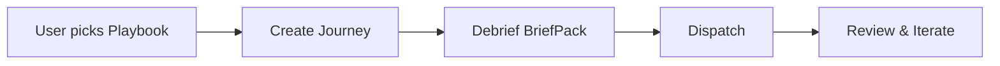

# Concepts

> **Audience:** :wrench: Prompt Engineers · :robot: Agents
>
> *Product readers: Scan for "Example:" or "Author checklist" sections for actionable guidance. Technical details can be skipped.*

## Introduction

This chapter expands the concise definitions in the Glossary into practical, author-facing concept pages. Use the [Glossary](./glossary.md) for quick lookups; each glossary term links to the matching section in this chapter for more detail, examples, and author guidance.

**Important:** Chapter 02 (Concepts) intentionally follows Chapter 01 (Glossary) one-for-one. If you add, rename, or remove a glossary term, update both files so links remain accurate.

---

## Guide Lifecycle

Everything in the dapple-prompt platform begins with a **guide**. Guides are authored as directories, parsed into structured data, and materialized into the database entities that power workflows. The lifecycle is:

```
guide directory --> parse --> IngestPlan --> materialize --> entities
```

Each stage is deterministic and inspectable. Authors write content once; the platform derives all the objects it needs.

<a id="guide-directory"></a>
### Guide Directory

A guide directory is the on-disk representation of a guide. It contains:

| Path | Purpose |
|------|---------|
| `guide.toml` | Metadata: title, author, version, classification, source path |
| `SUMMARY.md` | Chapter ordering and nesting (mdBook format) |
| `chapters/*.md` | Markdown content with directive blocks |
| `locales/*.ftl` | Fluent localization files (one per locale) |
| `assets/` | Images, documents, and other binary files referenced by content |

The directory is packaged as a tarball for ingest. See [Guide Directory Structure](./guide-directory-structure.md) for the full specification.

<a id="ingest-plan"></a>
### IngestPlan

The `IngestPlan` is the pure transform output produced by `plan_guide()`. It contains everything the materializer needs to create database entities, with no side effects or database access required to produce it.

**Contents of an IngestPlan:**
- Title, description, author, classification, source path (from `guide.toml`)
- Chapters and their blocks (from parsed markdown)
- Card metadata (from `:::brief_pack` Fluent attributes)
- Asset file entries (from `assets/` directory)
- Derived brief packs, playbooks, tasks, inference profiles, and refs (from directive blocks)
- Fluent message sets (from `locales/*.ftl` files, grouped by message key)
- Warnings (non-fatal issues discovered during transform)

The `IngestPlan` is the boundary between parsing and persistence. Use `dry_run=true` on the ingest endpoint to produce an `IngestPlan` without writing to the database.

<a id="derived-objects"></a>
### Derived Objects

Directive blocks in guide chapters are transformed into platform entities during the `plan_guide()` phase:

| Directive Block | Derived Object | Description |
|-----------------|---------------|-------------|
| `:::stage` | Stage in `derived_playbook` | A phase in the playbook |
| `:::step` | Step within a stage | A subgoal within a phase |
| `:::nushell` | Task in `derived_tasks` | A Nushell script to execute |
| `:::brief_pack` | BriefPack in `derived_brief_packs` | A package of debrief forms |
| `:::inference_profile` | InferenceProfile in `derived_inference_profiles` | Model configuration for prompts |
| `:::ref` | Ref in `derived_refs` | Cross-reference to shared content |

The `derived_playbook` captures the full stage/step hierarchy. Stages contain steps, steps reference tasks. The entire structure is extracted from the nesting of directive blocks in the markdown source.

<a id="dapple-sdk"></a>
### The Dapple SDK

The `dapple-sdk` crate provides typed Rust access to the platform. The primary entry point is `DappleClient`, which handles authentication, request batching, and response parsing. See the [API Consumer Guide - SDK Overview](../api-consumer-guide/sdk-overview.md) for usage details.

---

## Core Execution Model

<a id="task"></a>
### Task

A Task is the smallest unit of work: a short script or program that performs one clear job (for example: `collect-personal-data`, `format-resume`).

**Good Tasks:**
- Have a single responsibility and minimal external dependencies
- Accept inputs via `IN_ARTIFACT` or stdin and write outputs to `OUT_DIR`
- Produce an `artifact.json` describing the primary artifact (path and type)
- Are idempotent or include resume markers so retries are safe

**Example responsibilities:** Extract structured data from free text, render Markdown to PDF, validate an email address.

In the guide authoring workflow, tasks are defined using `:::nushell` directive blocks. The block content becomes the task script, and the block name becomes the task slug.

<a id="setup-step"></a>
### Setup Step

A Setup Step is a **dynamic sub-interaction within a [Stage](#stage)** — one round-trip of work (and any operator input it needs) that happens *before* the user navigates to the next stage. If a Stage is the form/pane, its Steps are the AJAXy interactions on that pane: the canonical shape is **generate → pick → refine** (a task generates candidates, the operator picks one, a later step refines the pick). The pick is normally one option; for a fan-out (curate *which subset* survives — "keep these 3") declare the pick slot `cardinality: "multi"` and the refine step receives an array. See [Multi-select picks (keep-N)](./value-slot-overlays.md#multi-select-picks-keep-n--curate-a-subset). A Step groups Tasks that run in a defined order, with deterministic artifact passing and simple retry/resume.

**Multi-step stages are the norm** — that is what Steps are *for*. A single-step stage is the degenerate case (a form with one round-trip), not the model. Author the value slots a *specific* step needs or **produces** at the step level (`:::step { expose: [...] }`).

**Author checklist:**
- [ ] Define the ordered Task list and expected artifact contract
- [ ] Document which artifact each Task consumes and produces
- [ ] Expose at the step level the slots this step needs/produces (including any computed `:::brief-output`) — see [Value-Slot Overlays](./value-slot-overlays.md)

**Example:** `build-resume-step` runs `collect-personal-data` -> `format-resume` -> `render-pdf`.

In guide authoring, steps are defined using `:::step` blocks nested inside `:::stage` blocks.

<a id="authoring-a-steps-tasks"></a>
#### Authoring a step's tasks

A step is an **ordered set of tasks executed as one fail-together unit** — a coherence + retry boundary (it is *not* a database transaction: nothing rolls back, and task attempts, payloads, and assets are always recorded as history). **Multiple tasks per step is the norm.** There are two ways to give a step its tasks, concatenated **nested-first**:

- **Nested (recommended).** Write `:::nushell` blocks as **children inside the `:::step` fence**. They are the step's private tasks, auto-scoped to the step name (`<step-name>/<task-name>`), and run in document order:

  ```
  :::step { name: "Build the menu", expose: ["menu"] }

  :::nushell { name: "get" }
  { payload: { ... }, signals: { } }
  :::

  :::nushell { name: "mangle" }
  { payload: { ... }, signals: { } }
  :::

  :::nushell { name: "check-safety" }
  { payload: { ... }, signals: { } }   # return signals.unsafe = true to veto
  :::

  :::
  ```

- **Referenced.** A `tasks: ["shared-a", "shared-b"]` attribute references shared `:::nushell` blocks defined at stage/chapter level. `task: "x"` is single-task sugar. (There is **no** `task_ref:` attribute.)

Every step that runs tasks needs at least one task (ingest rejects a task-less step that is not a pure operator-input checkpoint). A `:::nushell` with `role: "directive"` is flow control, not a task — see [Directives](./directives.md).

**Runtime rules authors must know:**

- Tasks run in **authored order**; the **first task failure stops the step** (later tasks do not run).
- A task may **veto** with `signals.unsafe = true` (plus an optional `reason`) → the step ends in a terminal `unsafe` phase, **do-not-retry**. An ordinary failure retries via re-dispatch.
- A computed `:::brief-output` (`source_kind: "computed"`) **publishes only when the whole step completes successfully**. Put a safety/validation check **after** the producer task, **in the same step**, or the unsafe value would already be live.

<a id="stage"></a>
### Stage

A Stage is a **static form / pane** the user lands on; advancing to the next stage (stage N → stage N+1) is the real navigation to the next pane. It holds one or more [Steps](#setup-step) — the dynamic sub-interactions on that pane before the user navigates on. Stages can pause for human review, branch, or trigger notifications. A stage's completion is the **roll-up of its steps**: it is `done` when every step is.

In guide authoring, stages are defined using `:::stage` blocks. The nesting of `:::step` blocks within a `:::stage` block defines the stage's step sequence.

<a id="playbook"></a>
### Playbook

A Playbook is the runnable orchestration authors build and package. It contains Stages and Steps arranged to produce a user-visible result. Playbooks are the unit you package into Brief Packs and the entity users run.

**Design guidance:** Keep Playbooks focused and composable; prefer many small Playbooks over large monoliths.

In the guide authoring workflow, the playbook is a derived object extracted from the hierarchy of `:::stage` and `:::step` directive blocks. Authors do not create playbooks directly; they emerge from the guide structure.

<!-- REVIEW: Verify this matches current Playbook schema in playbooks.rs -->

<a id="playbook-instance"></a>
### Playbook Instance / Run

A Playbook Instance (Run) is a single execution of a Playbook. The runtime creates an instance directory where Tasks write `OUT_DIR`, traces, and artifacts for that run.

<a id="journey"></a>
### Journey

A Journey is a product-level story describing user experience over time. A Journey may reference multiple Playbooks and includes UX-level decisions like gating, messaging, and long-lived state.

Treat Journeys as the product design layer; Playbooks implement runnable chapters within that story.



---

## Briefs & Debrief Content

<a id="brief"></a>
### Brief / BriefGroup / Brief Pack

| Concept | Description |
|---------|-------------|
| **Brief** | A versioned container for UI elements (inputs, outputs, markdown) used in debrief interviews |
| **BriefGroup** | An atomic collection of related Briefs that must be completed together |
| **Brief Pack** | A distributable package containing BriefGroups, assigned to Journeys at creation time |
| **Pack Manifest** | The manifest file (YAML/JSON) at the root of a Brief Pack describing contents and metadata |

**Key rule -- BriefGroup atomicity:** Users must complete all Briefs in a BriefGroup together. Your UI should present all BriefUnits from a single BriefGroup as one form section/screen. A debrief form-screen (a BriefGroup) is distinct from a playbook **step** — a step is a generate→pick→refine sub-interaction within a stage, surfaced via `GET /api/journeys/{id}/steps`.

**Hierarchy:**
```
Brief Pack
  +-- BriefGroup (atomic)
        +-- Brief (versioned)
              +-- BriefUnit (UI element: input, output, markdown, notice)
```

In guide authoring, brief packs are derived from `:::brief_pack` directive blocks. The block's Fluent attributes (`.card-subtitle`, `.card-category`) provide card metadata.

<a id="debrief-ux"></a>
### Debrief UX Patterns

When designing debrief interviews:

- **Never surface internal terms** like "Brief" -- use user-friendly labels like "form" or "step"
- **Structure questions** to minimize ambiguous free-text; prefer constrained inputs (selects, enums) where possible
- **Respect BriefGroup atomicity:** Either all questions in the group are answered or none are accepted

---

## Guides & Structured Content

{{#include ../_foundation/glossary.md:guides-and-content}}

**Key rule -- Guides are setup entities:** Guides provide reference content for journey workflows. They are not runtime execution objects -- no playbook or journey references a guide directly. Instead, agents and users query guide content as needed during journey execution.

**Block directive types vs flow-control directives:** Block directive types (prose, stage, step, nushell, ref) classify *content*. Flow-control directives (JSONLogic) control *execution*. These are distinct systems that share the word "directive." See [Directives and JSONLogic](./directives.md) for flow control; see [Directive Blocks](./directive-blocks.md) for block types.

**Audience tags replace emoji markers in API:** The :wrench:/:clipboard:/:robot: audience markers used in this documentation map to `agent`/`product`/`universal` tags when guide content is stored in the API.

**Guide lifecycle in context:** A guide directory is authored, ingested as a tarball, parsed by `dapple-parser` into a `ParsedGuide`, transformed by `plan_guide()` into an `IngestPlan`, and materialized into database entities. The derived objects (playbooks, tasks, inference profiles, brief packs) become the platform entities that power workflows. See [Ingest Pipeline](./ingest-pipeline.md) for the full pipeline.

**Hierarchy:**
```
Guide (versioned, path-level title + slug)
  +-- Chapter (ordered, nestable)
       +-- Block (directive_type, content, attributes, tags)
```

---

## Artifacts & Files

<a id="artifact"></a>
### Artifacts & artifact.json

Artifacts are files produced by Tasks (Markdown, PDFs, JSON). The minimal artifact contract is `artifact.json`:

```json
{
  "path": "./out/resume.pdf",
  "type": "application/pdf"
}
```

Authors should write artifact metadata consistently so downstream Tasks and the runtime can locate and use produced files.

<a id="checkpoint"></a>
### checkpoint.json & Human Review

Use `checkpoint.json` to record human approvals or review decisions at Step/Stage boundaries:

```json
{
  "approved": true,
  "notes": "Looks good."
}
```

The runtime uses checkpoint files to pause or resume Playbooks where configured.

<a id="logs"></a>
### Logging & Traces

| File | Purpose |
|------|---------|
| `log.jsonl` | Newline-delimited structured logs for machine consumption |
| `prompt-debug.json` | Records substituted prompts and raw model responses for LLM calls |
| `fluent-trace.json` | Serialized Fluent Message exchanges (system/user/assistant/tool) |

Write these artifacts to `OUT_DIR` for consistent collection.

<a id="async"></a>
### Async / pending.json

When a model call is long-running or async, Tasks should write `pending.json` with request metadata (e.g., `request_id`) so a separate worker can resume processing when the model result is ready.

<a id="errors"></a>
### Errors & error.json

If a Task fails, prefer writing `error.json` with a small payload so the runtime can display friendly diagnostics:

```json
{
  "message": "Failed to connect to PDF renderer",
  "code": 503
}
```

---

## Environment Variables

<a id="env-vars"></a>
### Runtime Environment Variables

The runtime exposes these env vars to Tasks:

| Variable | Description |
|----------|-------------|
| `OUT_DIR` | Where Tasks should write artifacts and logs |
| `IN_ARTIFACT` | Path to the previous Task's artifact (if any) |
| `PLAYBOOK_ID` | Identifier for the current Playbook |
| `STAGE_ID` | Identifier for the current Stage |
| `STEP_ID` | Identifier for the current Step |
| `TASK_ID` | Identifier for the current Task |
| `PROMPT_ID` | When a Task invokes prompts via the conduit |
| `CONDUIT_OPTIONS` | JSON blob with provider/model/options for conduit calls |

---

## Prompts & LLM Integration

<a id="prompt"></a>
### Prompt, Prompt Template, Prompt ID

| Term | Description |
|------|-------------|
| **Prompt** | The concrete text sent to a model after substitution |
| **Prompt Template** | A reusable file with placeholders like `{{user_text}}` |
| **Prompt ID** | A stable identifier pointing to a specific prompt template and version (e.g., `resume-data-extractor.v1`) |

Place templates in your pack under `prompts/<id>/template.txt` and include example inputs and expected outputs.

In the guide authoring workflow, inference profiles replace hardcoded model references. Authors define `:::inference_profile` directive blocks that specify model configuration via Fluent attributes (`.system-prompt`, `.temperature`, `.max-tokens`), making playbooks model-agnostic.

<a id="conduit"></a>
### Conduit (dapple-prompt-conduit)

The conduit is the runtime bridge that routes prompt text to configured providers and returns model responses. Authors should treat the conduit as a provider-agnostic layer that supplies `CONDUIT_OPTIONS` and `PROMPT_ID` to Tasks.

<a id="overlays"></a>
### Overlays & overlay_id

Overlays are runtime configuration bundles that change conduit routing or provider options without editing prompt templates.

**Precedence:** Prompt > Playbook > Pack > Global

Authors should include `overlay_id` in debug traces and design prompts to be provider-agnostic.

<a id="fluent"></a>
### Fluent Message

Fluent Messages are a structured exchange model (system/user/assistant/tool) for LLM interactions. Use Fluent Messages when you need typed or tool-enhanced conversations and persist the trace to `fluent-trace.json`.

In the guide authoring workflow, all localizable text lives in Fluent `.ftl` files under `locales/`. Message keys use kebab-case and correspond to directive block `name` attributes. See [Fluent Localization](./fluent-localization.md) for the full specification.

---

## Model Configuration

<a id="lineage"></a>
### Lineage (Prompting Paradigm)

A Lineage represents how you communicate with a family of models. Think of it as a "language" that models in the same family understand.

| Lineage | Prompting Style | Example Models |
|---------|-----------------|----------------|
| `claude-3-5` | Pseudo-XML structured prompts | Claude Sonnet, Opus, Haiku |
| `gpt-4` | Pseudo-JSON role definitions | GPT-4, GPT-4-turbo |
| `vits` | Speaker config with `speaker_id` | VITS TTS models |
| `flan-t5` | Task prefix + text | FLAN-T5 summarization |

**Key insight:** When you write a prompt template for a lineage, it works for any tier in that lineage. Switching from Sonnet to Opus doesn't require new templates.

<a id="provider"></a>
### Provider

A Provider is where a model is hosted and billed. The same lineage can be hosted by multiple providers:

- **anthropic** - Anthropic's hosted API
- **self-hosted** - Your own infrastructure
- **nvidia-nim** - NVIDIA's inference microservices

<a id="inference-profile"></a>
### InferenceProfile

An InferenceProfile maps prompts to models at Journey creation time. This makes Playbooks model-agnostic.

**Three-Part Journey Composition:**
```
Journey = Playbook + BriefPacks + InferenceProfiles
```

| Component | Purpose |
|-----------|---------|
| Playbook | What tasks to run |
| BriefPacks | What forms users fill out |
| InferenceProfiles | Which models to use |

**Benefits:**
1. Same Playbook works with different InferenceProfiles
2. A/B test model quality without changing workflow logic
3. Self-hosted vs API-hosted is a deployment choice

**Author guidance:**
- Don't hardcode model references in Playbooks
- Design prompt templates for lineages, not specific tiers
- Let InferenceProfiles handle model selection at Journey creation
- In guide authoring, use `:::inference_profile` directive blocks to define profiles declaratively

---

## Best Practices

<a id="idempotency"></a>
### Idempotency & Versioning

- **Idempotency:** Design Tasks so retries are safe or detect and resume partial work
- **Versioning:** Use stable naming patterns for prompts and packs (`resume-data-extractor.v1`, `brief-pack-0.1.0`) and archive incompatible changes

<a id="naming"></a>
### Naming Conventions

Use short kebab-case identifiers for Task/Step/Stage/Playbook names:

| Type | Example |
|------|---------|
| Task | `format-resume`, `render-pdf` |
| Step | `build-resume-step` |
| Stage | `stage-1`, `data-collection` |
| Playbook | `build-resume-playbook` |

In guide authoring, these names come from the `name` attribute in directive blocks and must match the corresponding Fluent message keys in `locales/*.ftl`.

---

## Testing

<a id="scenariocontext"></a>
### ScenarioContext (testing)

`ScenarioContext` is a testing helper referenced in lifecycle tests. It records named batches, created objects, and helps tests wait for required shared dependents.

**Guidance for authors reviewing tests:**
- Name the first batch for an endpoint `"{endpoint}-init"`
- Preserve ordering for multi-row inserts
- Prefer polling `ScenarioContext` for shared dependents rather than sleeping
- When tests fail, log the `CreateXSchema` payload and the lengths of constructed `InsertXArgs`

**Key files:**
- `crates/dapple-prompt-api/tests/`
- `crates/dapple-prompt-api/tests/consumer/mod.rs`
