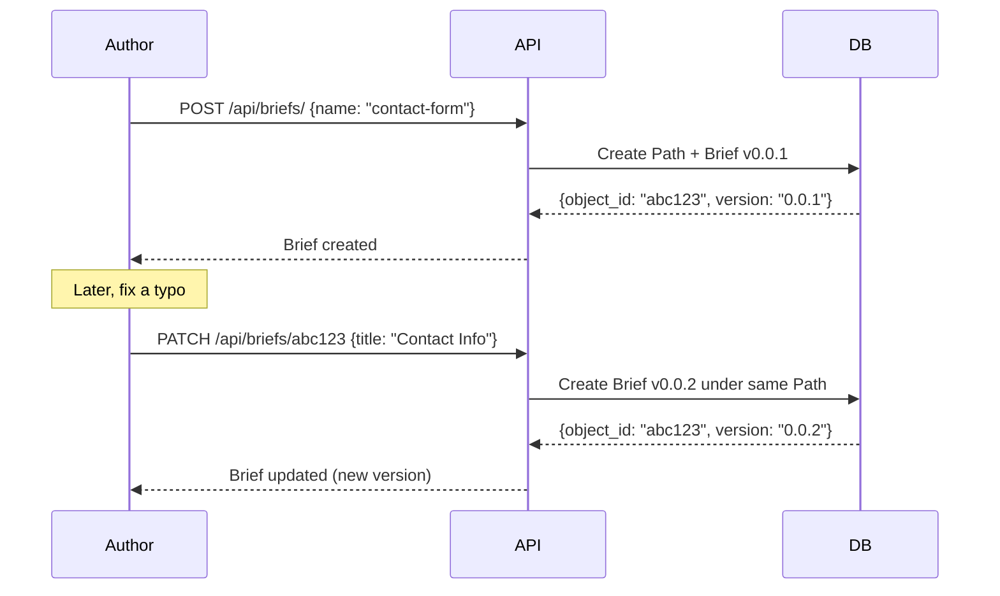

# Versioning

> **Audience:** :wrench: Prompt Engineers · :clipboard: Product · :robot: Agents

This chapter explains the versioning model used throughout the platform for Guides, Briefs, BriefGroups, BriefPacks, and other versioned objects.

---

## Why Versioning Matters

Versioning enables:

- **Safe rollback** — Revert to a previous version if a change causes problems
- **A/B testing** — Run different versions simultaneously to compare results
- **Audit trails** — Track what version was used for each Journey
- **Gradual rollout** — Deploy new versions to a subset of users first
- **Reproducibility** — Replay a Journey with the exact same content

---

## Versioning Concepts

### Versioned Objects

The following objects support versioning:

| Object | Version Pattern | Example |
|--------|-----------------|---------|
| Guide | Semantic (`major.minor.patch`) from `guide.toml` `version` field | `0.1.0`, `1.0.0`, `1.0.1` |
| Brief | Semantic (`major.minor.patch`) | `1.0.0`, `1.0.1`, `2.0.0` |
| BriefGroup | Semantic | `1.0.0` |
| BriefPack | Semantic | `0.1.0`, `1.0.0` |
| ValueSlot | Semantic | `1.0.0` |

Guide versions are declared in `guide.toml` and validated as semver during ingest. The version field is the single source of truth for a guide's version number.

### Path Objects

Every versioned object has an associated **Path** that represents the object's identity across all versions:

```
Path (identity)
  └── Version 1.0.0
  └── Version 1.0.1
  └── Version 2.0.0
```

- The **Path** has a stable `object_id` (UUID) that never changes
- Each **Version** is immutable once created
- References use the Path's `object_id` to get the latest version by default

### Version Components

| Component | When to Increment | Example Change |
|-----------|-------------------|----------------|
| **Major** | Breaking changes | Schema incompatibility, removed fields |
| **Minor** | New features | Added optional fields, new functionality |
| **Patch** | Bug fixes | Typo fixes, clarifications |

---

## Prompt and Inference Profile Versioning

Prompts are now defined as `:::inference_profile` directives within guides. They are versioned alongside the guide itself rather than independently. When you update a prompt's system prompt, description, temperature, or other Fluent attributes, you create a new guide version that carries the updated inference profile definition.

See [Defining Inference Profiles](./defining-inference-profiles.md) for the directive syntax and Fluent attribute reference.

---

## Brief/BriefGroup/BriefPack Versioning

These objects use semantic versioning with automatic version creation.

### How It Works

1. **Create** — First insert creates version `0.0.1` and a new Path
2. **Update** — PATCH creates a new version, incrementing patch by default
3. **Reference** — Use Path's `object_id` to reference across versions

### Example Lifecycle



### Version Resolution

When fetching objects:

| Query | Result |
|-------|--------|
| `GET /api/briefs/?ids=["abc123"]` | Returns **latest** version |
| `GET /api/briefs/?ids=["abc123"]&version=0.0.1` | Returns specific version |

### Immutability

Once created, a version cannot be modified. To change content:

1. PATCH the object with new values
2. A new version is automatically created
3. Previous versions remain accessible

---

## Version References in Associations

When objects reference other versioned objects, the reference is to the **Path**, not a specific version:

```json
{
  "name": "contact-group",
  "brief_object_ids": ["abc123", "def456"]
}
```

This means:
- The BriefGroup references the **current** versions of these Briefs
- If a Brief is updated, the BriefGroup automatically uses the new version
- To pin to a specific version, use explicit version references (when supported)

---

## Pack Versioning

Guide directories replace the legacy pack manifest approach. Version your guide through `guide.toml`'s `version` field. Brief packs defined as `:::brief_pack` directives within a guide are versioned alongside the guide itself.

---

## Guide Versioning

Guides follow the standard versioned object pattern. The version number comes from the `version` field in `guide.toml`, validated as semver during ingest.

### POST Ingest (New Guide)

Uploading a guide tarball via `POST /api/guides/ingest` creates:

1. A new **Path** (identity) for the guide, holding the title and slug
2. The **first version** with the semver from `guide.toml`
3. All derived objects (playbook, stages, steps, tasks, brief packs, inference profiles)

### PATCH Ingest (New Version)

Uploading a guide tarball via `PATCH /api/guides/ingest` creates:

1. A new **version** under the existing path, using the semver from `guide.toml`
2. Updated derived objects reflecting the new guide content

The path's title and slug remain stable across all versions. The `guide.toml` `version` field must be a higher semver than the previous version.

### No Separate Paths Endpoint

Unlike briefs, prompts, and assets, guides do **not** have a `/api/guide-paths/` endpoint. To retrieve all versions of a guide, use the `by_path_ids` query variant on the main endpoint:

```
GET /api/guides/?query=by_path_ids&path_ids[0]=path-uuid
```

### Deprecation

Guides support the standard deprecation pattern via DELETE with three levels:

| Level | Meaning |
|-------|---------|
| `deprecated` | Soft deprecation — still accessible but discouraged |
| `retired` | Removed from active use |
| `quarantined` | Flagged for review, access restricted |

The `object_id` in DELETE requests refers to the **path** object ID (not the version object ID). Deprecation can also be declared in `guide.toml` via the `[deprecation]` table, which is applied during ingest.

For full API examples, see the [API Consumer Guide — Guides and Directives](../api-consumer-guide/guides-and-directives.md).

---

## Best Practices

### For Guide Authors

1. **Follow semver strictly** — Users depend on version guarantees in `guide.toml`
2. **Use dry run first** — Validate with `dry_run=true` before materializing
3. **Increment patch for small fixes** — Typos, wording adjustments, clarifications
4. **Increment minor for new content** — New stages, steps, or directive blocks
5. **Increment major for breaking changes** — Restructured playbooks, removed steps, changed task contracts
6. **Test the whole guide** — Verify all derived objects (playbook, tasks, brief packs) work together after versioning

### For Brief Authors

1. **Use descriptive titles** — Help users understand what changed
2. **Group related changes** — Batch small fixes into one patch version
3. **Communicate major versions** — Warn users before breaking changes
4. **Archive old versions** — Document deprecated versions

---

## Version Compatibility Matrix

When composing objects, ensure version compatibility:

```
BriefPack v1.0.0
  └── requires BriefGroup v1.x (compatible with v1.0.0 - v1.9.9)
        └── requires Brief v2.x (compatible with v2.0.0 - v2.9.9)
              └── uses Prompt resume-extractor.v2
```

### Compatibility Rules

| Dependency Type | Compatible Versions |
|-----------------|---------------------|
| Same major | Always compatible |
| Different major | Requires explicit testing |
| Unversioned | Assumes latest, may break |

---

## Migration Guide

### Upgrading Prompt Versions

```nushell
# Old: hardcoded version
let prompt_id = "resume-extractor.v1"

# New: use environment variable with fallback
let prompt_id = $env.PROMPT_ID? | default "resume-extractor.v2"
```

### Handling Version Mismatches

```nushell
def main [] {
    let expected_version = "2"
    let actual = $env.PROMPT_VERSION? | default "unknown"

    if $actual != $expected_version {
        print $"Warning: Expected prompt v($expected_version), got v($actual)"
    }

    # Continue with version-aware logic...
}
```

---

## API Reference

### Create Versioned Object

```json
POST /api/briefs/
{
  "objs": [
    {
      "name": "contact-form",
      "title": "Contact Information"
    }
  ]
}
```

Response includes version:
```json
{
  "objs": [
    {
      "object_id": "abc123",
      "name": "contact-form",
      "version_major": 0,
      "version_minor": 0,
      "version_patch": 1
    }
  ]
}
```

### Update (Create New Version)

```json
PATCH /api/briefs/abc123
{
  "title": "Contact Info (Updated)"
}
```

Response shows new version:
```json
{
  "object_id": "abc123",
  "version_major": 0,
  "version_minor": 0,
  "version_patch": 2
}
```

### Fetch Specific Version

```
GET /api/briefs/?ids=["abc123"]&version=0.0.1
```
